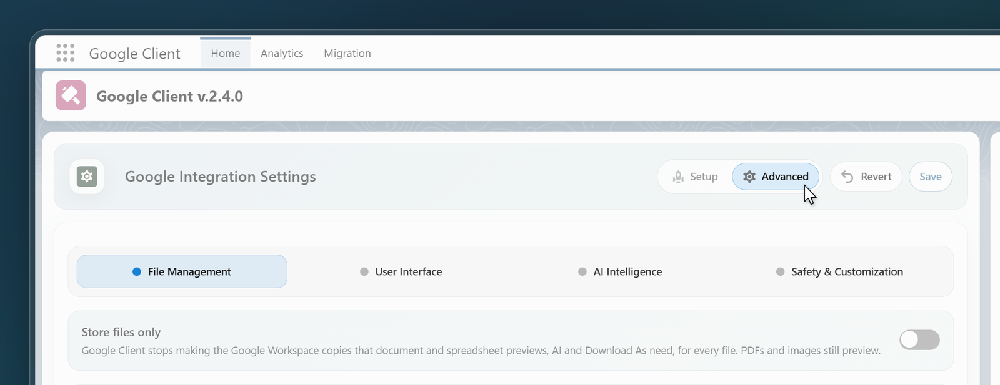

# Advanced Settings

Advanced settings live in the **Google Client** app on a screen of their own, grouped into four tabs. Every one of them is optional.

A freshly installed package works fully without any of them, and a blank field always means "use the default". The same holds after an upgrade: a setting added in a new release starts out blank and keeps the behavior you already had until you choose otherwise.

## Opening them

1. Open the **Google Client** app from the App Launcher.
2. Go to the **Home** page.
3. Select **Advanced** at the top right, next to **Setup**.

If you have unsaved changes on the Setup screen, Google Client asks whether to save or discard them before opening Advanced, so the two never mix. While an Advanced tab is open, the side panel of the Home page shows a short guide to that tab.

## The four tabs

- **[File Management](advanced/file-management.md)**

    Store files only, upload transport, Open in Google Drive, file size, deletion and the domain public links are limited to.

- **[User Interface](advanced/user-interface.md)**

    Which columns appear in File Explorer, in what order, including your own fields.

- **[AI Intelligence](advanced/ai-intelligence.md)**

    Turn AI Analytics on, shape the prompts and the length of summaries and answers, and let Google Client label new files automatically.

- **[Safety & Customization](advanced/safety-customization.md)**

    How strictly AI questions and answers are inspected, and how to replace that inspection with your own.

## Looking for something else?

A few settings people expect to find here belong to a setup step instead:

- [Folder Structure](folder-structure.md): organizing uploads in Google Drive by user, by record or both, and naming those folders
- [Multiple Upload Folders](multiple-drives.md): fallback destinations for when a drive fills up
- [Google Workspace Folder](workspace-copies-folder.md): a folder of their own for the copies made for previews, AI and Download As
- [Configure Google Workspace](../setup/configure-drive.md): the service account, the certificate, the upload folder and the custom authorizer class
- [Configure AI & Intelligence](../setup/configure-intelligence.md): connecting Gemini or Agent Platform

 
