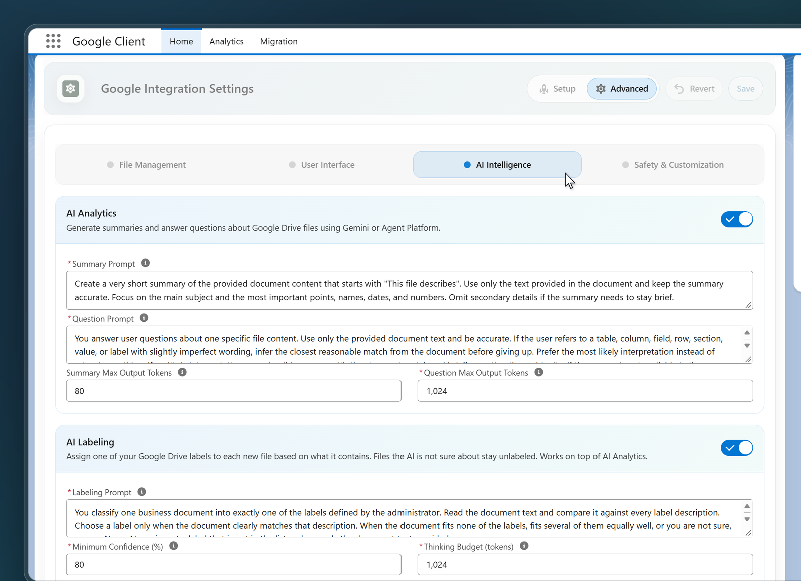
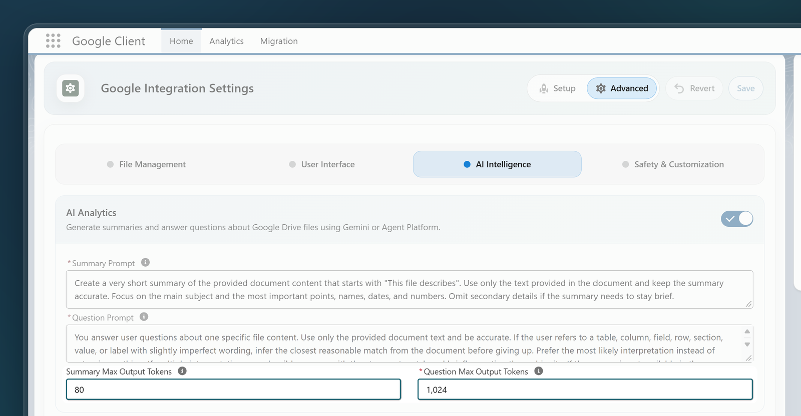
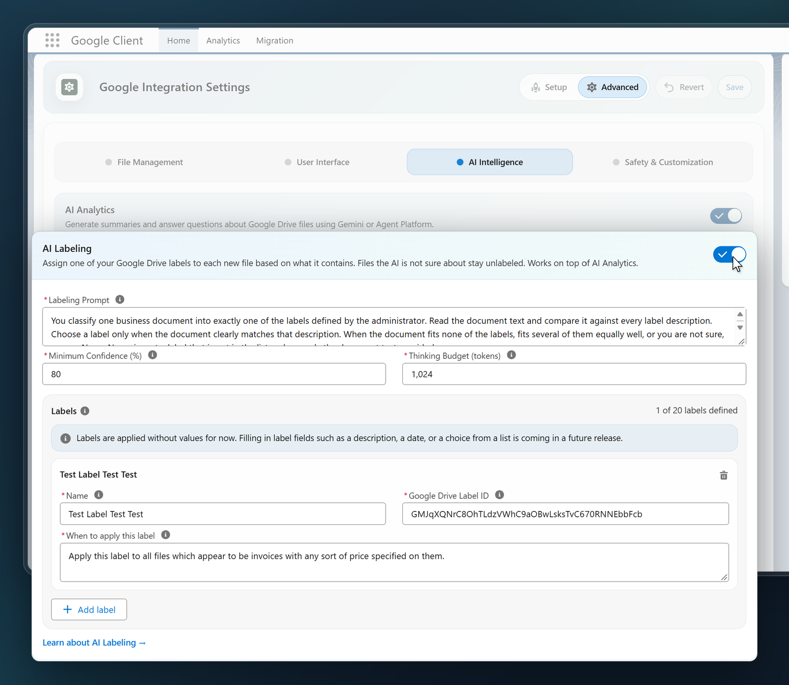

# Advanced: AI Intelligence

Turn AI Analytics on, shape how the AI provider is asked to respond, and let Google Client label files automatically.

Open the **Google Client** app → **Advanced** → **AI Intelligence**. The tab has two sections, **AI Analytics** for summaries and questions and **AI Labeling** for automatic labels. Both need a connected provider.

📘 See [Configure AI & Intelligence](../../setup/configure-intelligence.md)

## AI Analytics

The main switch for summaries, file Q&A and labeling. It can be turned on once Gemini or Agent Platform is saved, and turning it on checks the provider first. While it is off, nothing is sent to any AI provider and the AI controls are hidden, while existing summaries and labels are kept.

| Setting | What it does |
|---|---|
| **Summary Prompt** | How the provider is asked to describe a file. The shipped prompt asks for a very short summary that starts with "This file describes", drawn only from the document. |
| **Question Prompt** | How the provider is asked to answer a question about a file. The shipped prompt asks for short, plain-text answers drawn only from the document, and sets the reply used when the answer is not in it. |
| **Summary Max Output Tokens** | How long a summary may be. Empty means 80, and `0` means no limit. A summary is always cut to 255 characters. |
| **Question Max Output Tokens** | How long an answer may be, which is most of what the provider bills for a question. `0` means no limit. |

Google Client waits up to two minutes for each answer. A summary or label that fails because the service is slow or busy is tried again twice over the next few minutes. A question is not: the person asking is told and can ask again.

📘 See [Document Summaries](../../features/artificial-intelligence/summaries.md) and [File Q&A](../../features/artificial-intelligence/file-qa.md)

## AI Labeling

Gives each new file one of your Google Drive labels based on what it contains. It is off by default, and available only while AI Analytics is on.

| Setting | What it does |
|---|---|
| **Labeling Prompt** | How the provider is asked to choose a label. The shipped prompt picks a label only on a clear match and answers *None* otherwise. Your label descriptions are added to it automatically. |
| **Minimum Confidence (%)** | How sure the AI must be, from 0 to 100, before a label is applied. The default is 80. |
| **Thinking Budget (tokens)** | How much room the AI gets to reason before it chooses. The default is 1024, and `0` turns reasoning off where the model allows it. |

### Labels

Up to 20 labels can be defined, each with:

| Field | What to enter |
|---|---|
| **Name** | What the label is called in Salesforce, for example *Invoice* |
| **Google Drive Label ID** | The ID of the published label, shown in the Google Admin console |
| **When to apply this label** | A plain-language description of the documents the label is for |

A label is saved only with all three filled in, and a duplicate name is ignored. Labels are applied without field values. A wrong label ID is not caught on save: Google Drive refuses the label, the file stays unlabeled and the refusal is recorded in the logs.

📘 See [File Labeling](../../features/artificial-intelligence/labeling.md)

## Safety

Prompt inspection has a tab of its own, since it applies to every prompt.

📘 See [Safety & Customization](safety-customization.md)

 
