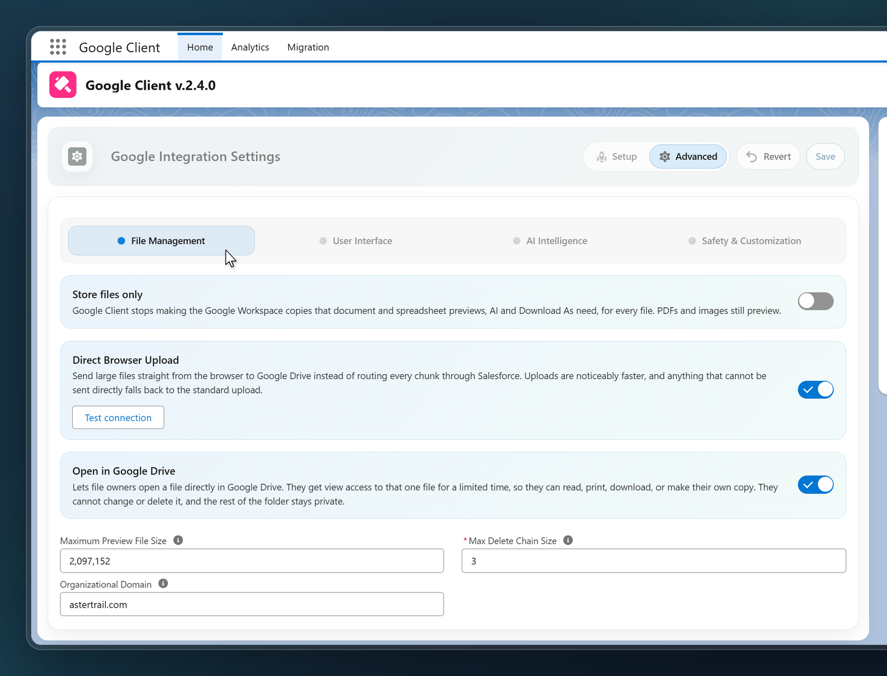
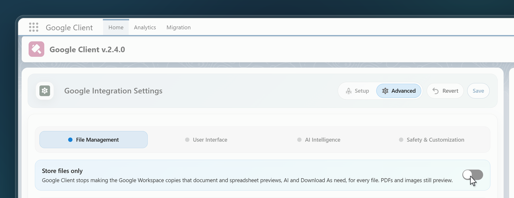
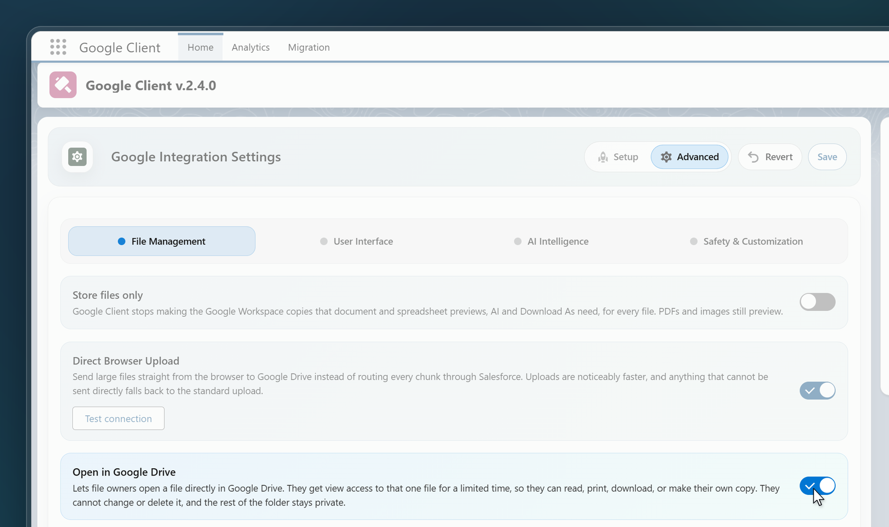
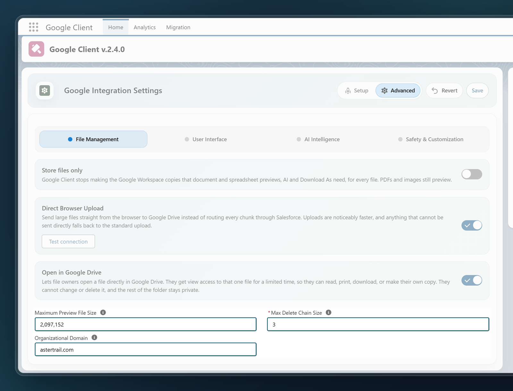
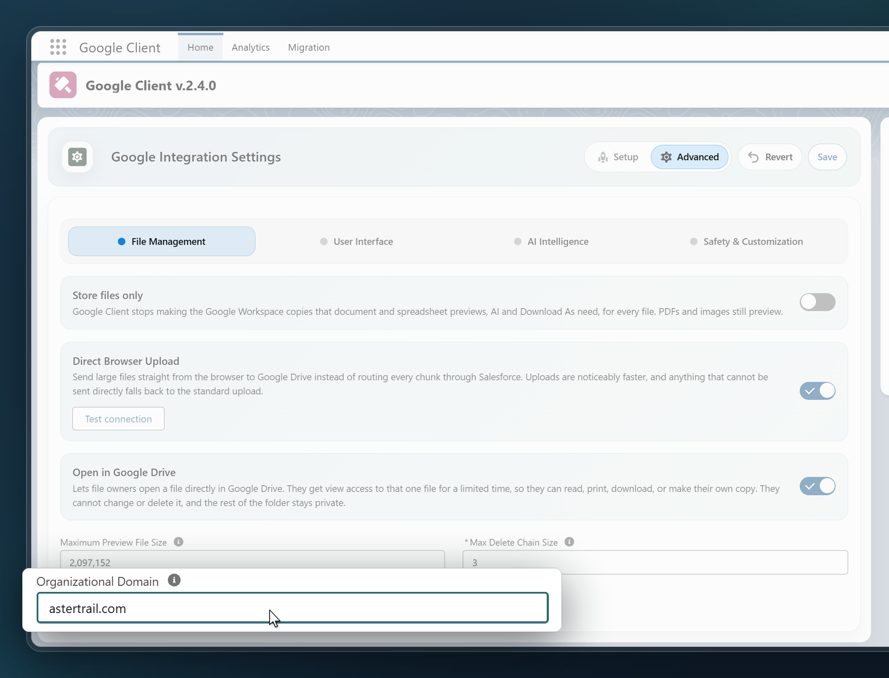

# Advanced: File Management

How files are stored, uploaded and previewed, plus the domain public links are limited to.

Open the **Google Client** app → **Advanced** → **File Management**.

## Store files only {#file-preview}

Google Client keeps a Google Workspace copy of most files (Word, Excel, CSV, PDF and images) in Google Drive. Previews of documents and spreadsheets, Download As, AI and reading a file's text all work from that copy.

**Store files only** stops making those copies. With it on:

- PDFs and images still preview.
- Uploading, downloading, sharing, versioning and linking work as before.
- Previews of documents and spreadsheets, Download As, and AI summaries, questions and labels are unavailable for every file. Summaries and labels already stored stay visible.
- Only plain text files can be read as text.

Copies that already exist stay in Google Drive, and files uploaded while it is on stay without one.

To keep the copies in a folder of their own instead, see [Google Workspace Folder](../workspace-copies-folder.md).

## Direct Browser Upload

Sends large files from the browser straight to Google Drive, which makes large uploads noticeably faster. It is **off by default**, and once it is saved, **Test connection** checks the whole path without leaving a file in Google Drive.

📘 See [Direct Browser Upload](../direct-browser-upload.md)

## Open in Google Drive

Lets the owner of a file open it in Google Drive, with view access to that one file. Only internal users who own the file see the option. It is **off by default**.

📘 See [Open in Google Drive](../../features/open-in-drive.md)

## Maximum Preview File Size

The size, in bytes, above which a file counts as large. It limits previews of documents and spreadsheets, Download As, and what the **Upload File to Google Drive** flow action uploads straight away; larger files from that action finish uploading in the background. PDFs and images preview whatever the value.

Blank, or `0`, means the largest size your Salesforce release supports, which the help text next to the field shows. An org that saved its settings in an earlier version has `2097152` (2 MB) stored here, and clearing the field switches it to the automatic size. A value above the automatic size gives errors rather than larger previews.

## Max Delete Chain Size

How many items in Google Drive one background job removes after a file is deleted, from 1 to 50. The default is **3**. A file with many versions leaves several items behind, and a higher value removes them in fewer jobs.

## Organizational Domain

The Google Workspace domain public links are limited to, entered on its own, such as `example.com`.

With a domain set, the Public Link window shows a checkbox. Unchecked, which is the default, the link opens only for people signed in to that domain. Checked, it opens for anyone who has it. With the field blank, every public link opens for anyone.

📘 See [Public Links](../../features/public-links.md)

 
