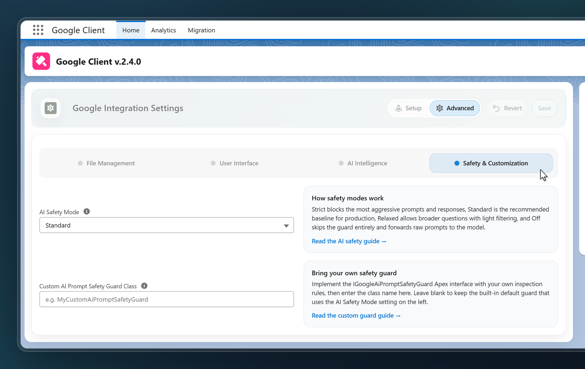

# Advanced: Safety & Customization

How strictly AI questions and answers are inspected, and how to replace that inspection with your own.

Open the **Google Client** app → **Advanced** → **Safety & Customization**.

## AI Safety Mode

Sets how strictly questions and answers are inspected.

| Mode | Questions | Answers |
|---|---|---|
| **Strict** | Checked, with a shorter length limit | Checked, and also rejected if the answer contains code blocks or links that are not in the document |
| **Standard** | Checked | Checked |
| **Relaxed** | Not checked | Checked |
| **Off** | Not checked | Not checked |

## Custom AI Prompt Safety Guard Class

Replaces the shipped inspection with your own Apex class.

Blank uses the shipped inspection. Otherwise, enter the class name only, without a namespace. If the class cannot be found or does not implement the required interface, Google Client falls back to the shipped inspection rather than leaving AI unprotected.

📘 See [Bring your own guard](../../features/artificial-intelligence/safety.md#ownguard) for the interface, a working example and what to watch out for.

 
