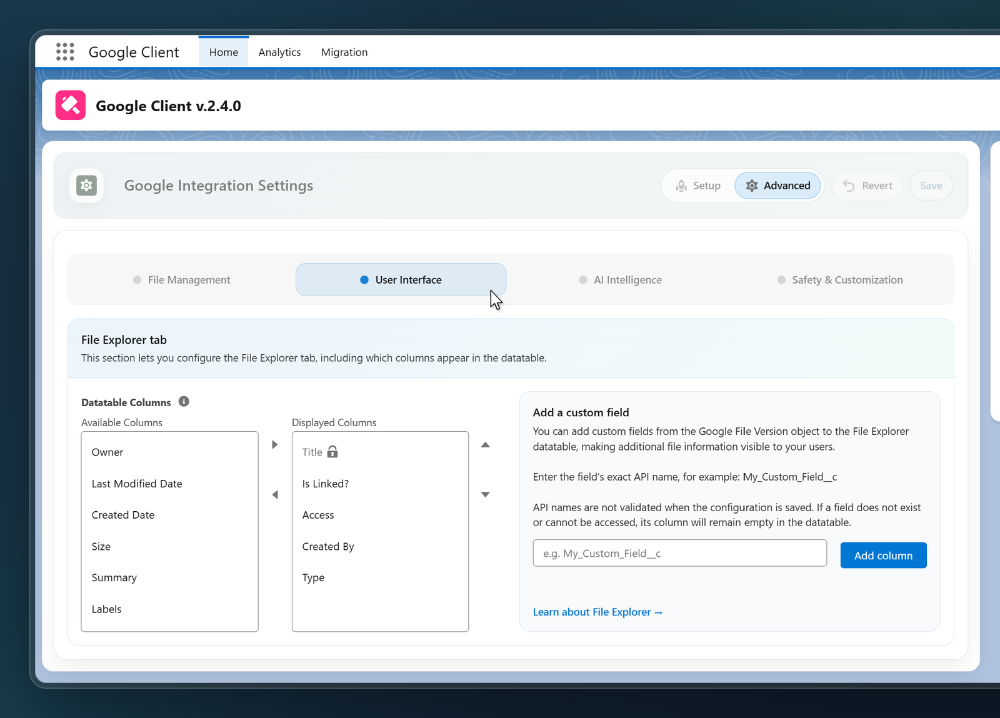

# Advanced: User Interface

Control how Google Client looks to the people using it.

Open the **Google Client** app → **Advanced** → **User Interface**. The tab has one section, **File Explorer**.

## File Explorer

Chooses which columns the file list shows, and in what order. The choice applies to every user.

### Columns

Move columns from **Available Columns** to **Displayed Columns**, then drag them into the order you want.

| Column | Shows |
|---|---|
| **Title** | The file name, and the link users click to preview it |
| **Type** | The file format |
| **Size** | The file size |
| **Created By** | Who added the file to Salesforce |
| **Owner** | Who owns the file, including when that is a group or a queue |
| **Created Date** | When the file was added |
| **Last Modified Date** | When the file was last changed |
| **Is Linked?** | Whether the file is attached to a Salesforce record |
| **Access** | The viewing user's own access level, View or Edit |
| **Summary** | The AI summary of the file |
| **Labels** | The Google Drive labels applied by AI, separated by semicolons |

- **Title is always displayed first** and cannot be removed, because it is what users click to open a file.
- **Up to 7 columns** can be displayed.
- **Title**, **Is Linked?**, **Created By**, **Owner** and the two date columns can be sorted. The others cannot.

Left untouched, the list shows **Title**, **Is Linked?**, **Access**, **Created By** and **Last Modified Date**.

### Adding your own field

Any field of the **Google File Version** object can be added as a column. Enter its exact API name, for example `My_Custom_Field__c`, in the **Add a custom field** box and select **Add column**.

The name is not checked when you save: a field that does not exist, or that the user cannot read, shows as an empty column, and fields that hold sensitive data are never shown.

 
