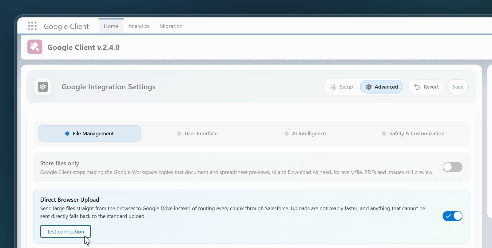

# Direct Browser Upload

Direct Browser Upload sends the content of large files from the browser straight to Google Drive, instead of passing every piece through Salesforce first. Large uploads become noticeably faster.

Salesforce still opens and completes every upload, so the file's record, its folder and its access are set exactly as before. Only the path the content takes changes, and small files keep using the standard upload.

It is **off by default**.

## Prerequisite: CSP Trusted Site

Google Client ships a CSP Trusted Site named **GoogleDriveDirectUpload** that lets the browser connect to `https://www.googleapis.com`, and to nothing else. No upload uses it until the setting is turned on, and a package upgrade restores it if it was changed or deactivated.

## Enabling it

1. Open the **Google Client** app.
2. Go to **Advanced** → **File Management**.
3. Turn on **Direct Browser Upload** and save.
4. Select **Test connection**.

The test starts a real upload, sends a small piece of content and cancels it, so no file is created in Google Drive. A successful test means the service account, the upload folder and the browser connection all work together. When the test says the browser could not reach Google, the **GoogleDriveDirectUpload** CSP Trusted Site is missing or inactive in Setup.

## When an upload cannot be sent directly

Nothing is lost if a direct upload does not complete. Brief network errors are retried automatically, and if the upload still cannot finish, the user is offered a retry through the standard upload, on the file card in the **Uploader** and at the bottom of the upload window in **Attachments** and **File Explorer**.

Once the user accepts a retry, the rest of that browser session uses the standard upload. Every direct upload that failed or was recovered is recorded in the logs and shows on the Analytics dashboard.

## Experience Cloud

Direct Browser Upload works on Experience Cloud sites with no extra configuration.

 
