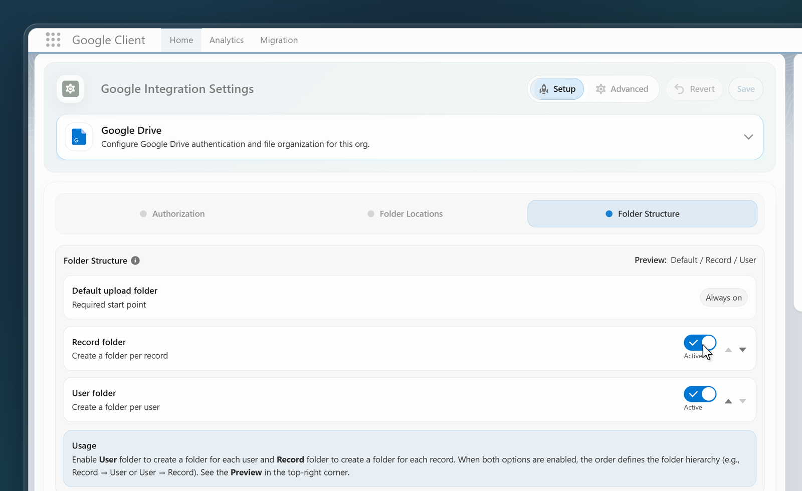
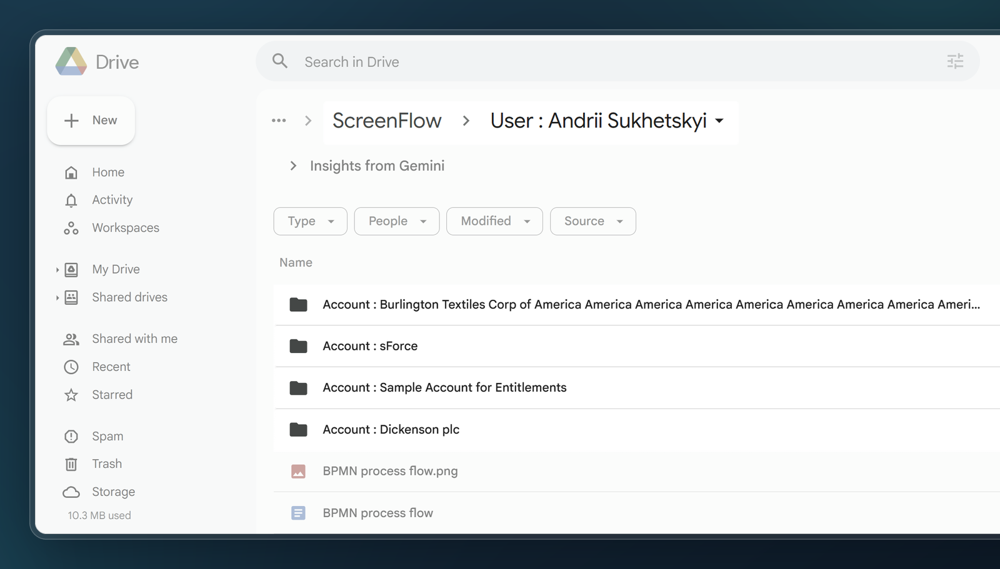
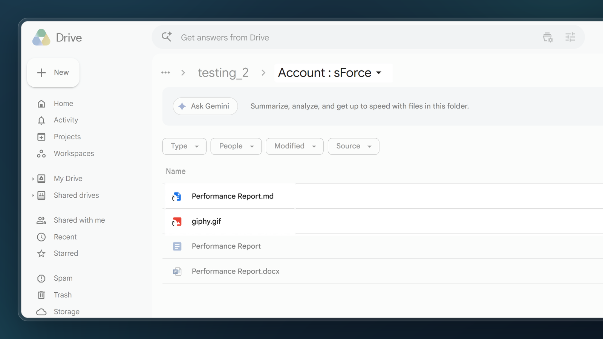
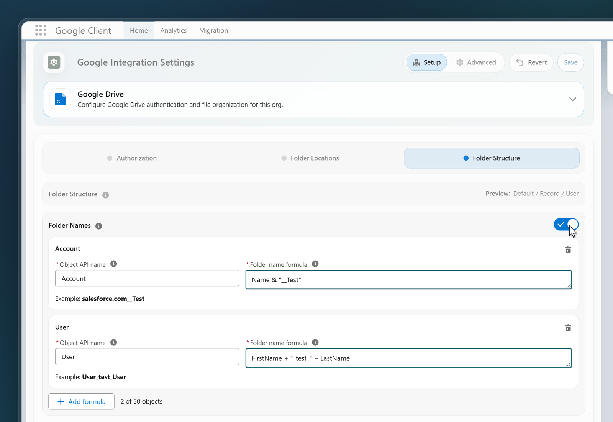

# Folder Structure

Folder Structure decides where uploaded files land in Google Drive and how those folders are named, so Drive stays organized without anyone sorting files by hand.

## Where to configure it

In the **Google Client** app, expand the **Google Drive** section under **Google Integration Settings** and go to the **Folder Structure** step.

## How folder structure works

Without a structure, every file goes straight into the **default upload folder**.

Turn on one or both levels to sort files into folders:

- **Record folder** creates a folder for each Salesforce record.
- **User folder** creates a folder for each user.

With both on, their **order** sets the hierarchy: **Record → User** puts a folder per user inside each record's folder, and **User → Record** the other way round. The **Preview** at the top of the step shows the resulting path.

## When it applies

The structure applies to every upload through Google Client, on a record, as a new version or from File Explorer.

When an existing file is attached to another record, the file stays where it is, and a Google Drive shortcut to it is added to the newly linked record's folder:

| Folder structure | When an existing file is attached |
|---|---|
| None, files go into the default upload folder | No shortcut is created |
| Folder per User | No shortcut is created |
| Folder per Record | A shortcut is created in the record folder |
| Folder per User → Record | A shortcut is created in the record folder inside the user folder |
| Folder per Record → User | A shortcut is created in the user folder inside the record folder |

!!! note
    Files reach their folders in the background, usually within a minute of the upload. If a record ends up with two folders, see [Known Issues](../help/known-issues.md).

## Folder names

Every folder is named when it is created:

- A record folder as `<Object> : <record name>`, for example `Account : Acme`
- A user folder as `User : <First name> <Last name>`, for example `User : Jane Doe`

To name an object's folders differently, add a row under **Folder Names** with the object, such as `Account`, `Opportunity` or `User`, and a Salesforce formula that returns text. The formula can use the record's fields and the fields of records related to it, and each row shows an example name as you type.

| Object | Formula | Folder name |
|---|---|---|
| Account | `Name & "_" & AccountNumber & "_" & TEXT(Contract_Date__c)` | `ABCD_10042_2026-10-24` |
| Opportunity | `Name & " (" & Account.Name & ")"` | `Renewal 2027 (Acme)` |
| User | `LastName & ", " & FirstName` | `Doe, Jane` |

Objects without a row keep the usual names, and a record whose fields in the formula are all blank does too.

- Dates, numbers and picklists need `TEXT()`. A date reads `2026-10-24`, a date and time `2026-10-24 23:30:00Z` in GMT, and a picklist gives its stored value, so a folder gets the same name whoever uploads.
- `$User` and other values that depend on who is signed in are not available, and neither is a person's full name: use `FirstName & " " & LastName`.
- Where the owner can also be a queue, as on Lead or Case, the owner is written with its type, such as `Owner:User.LastName`, and only its name fields can be used.
- A name longer than 255 characters is cut.

Folder names, including values taken from related records, are visible to everyone who can open the folder in Google Drive.

## Renaming folders

With the toggle beside **Folder Names** on, a folder follows its record. When a record is renamed, or its formula gives a different name, its folder takes the new name the next time a file is added to it. Files, links and sharing are untouched.

The toggle is off by default, and while it is off no folder is ever renamed. Folders are never renamed in bulk, so a record that gets no new file keeps its folder's old name.

 
