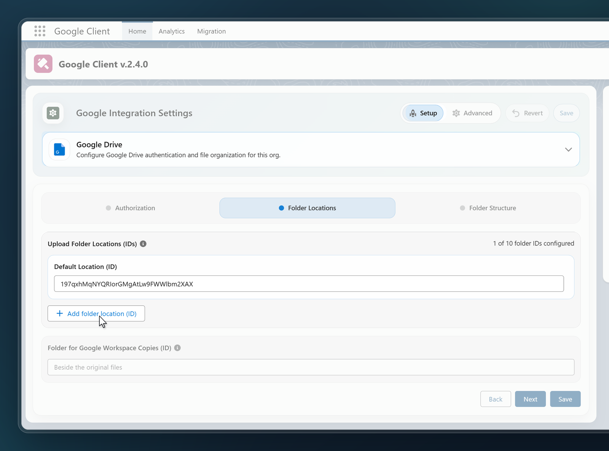

# Multiple Upload Folders

A Google Drive or shared drive has hard limits on how much it can hold, and once one is reached, uploads into it stop working, however much quota the service account has. With more than one upload folder, uploads keep working when that happens.

## Configuring the folders

1. Open the **Google Client** app.
2. Expand the **Google Drive** section and go to the **Folder Locations** step.
3. Add the folders under **Upload Folder Locations (IDs)**.

Up to **ten** folders can be configured, and the order matters.

## How the order is used

1. The **first** folder in the list is the primary destination. Everything is uploaded there while it has room.
2. If Google refuses an upload because the drive or folder is full, Google Client tries the **next** folder in the list, and carries on down the list until one accepts the file.
3. The folder that accepted the file becomes the root for that upload, and any [folder structure](folder-structure.md) is created inside it.

The user notices nothing: the upload simply succeeds. Files already stored are never moved, so a record can have files on more than one drive, and every component still finds them.

## What counts as full

Google Client moves to the next folder only when Google reports a hard capacity limit: a shared drive reaching its item limit, the storage quota running out, or a folder reaching the maximum number of items it can hold.

Any other failure, such as a bad file, an expired sign-in or a network problem, is shown to the user as an error, since another folder would not fix it.

 
