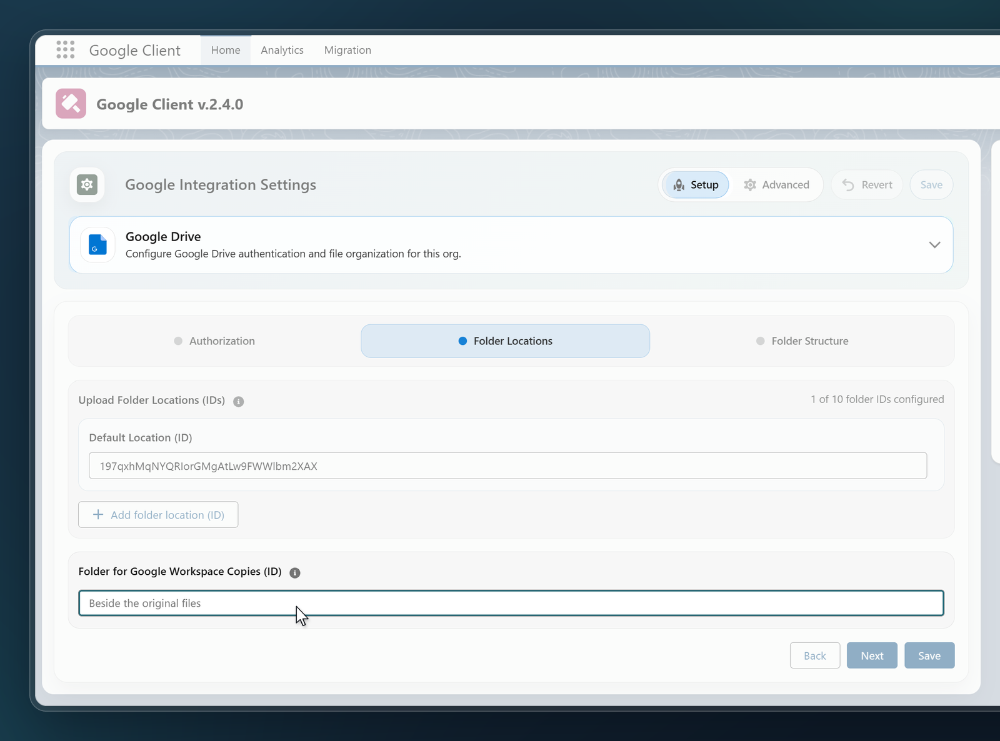

# Google Workspace Folder

For most files (Word, Excel, CSV, PDF and images) Google Client keeps a second, Google Workspace version in Google Drive. That copy is what makes previews of documents and spreadsheets, Download As, AI summaries, questions and labels, and reading a file's text possible. By default each copy sits beside its original, in the record or user folder.

Give the copies a folder of their own, and record folders hold only the files people uploaded. Everything that uses the copies works the same, and only the place where they live changes.

## Choosing the folder

1. Open the **Google Client** app.
2. Expand the **Google Drive** section and go to the **Folder Locations** step.
3. Enter the folder's ID in **Folder for Google Workspace Copies (ID)**, below the upload folders.
4. Click **Save**.

Leave it **blank** to keep each copy beside its original.

Google Client checks the folder as soon as you enter it and shows its name, or says why it cannot be used: it cannot be reached, it is not a folder, it is in the trash, or the service account cannot add files to it. The service account needs **Content manager** access to it.

The copies hold the full content of every file, and when the folder cannot take one, because it was deleted, unshared or is full, the copy is made beside its original instead. Changing the folder affects new copies only.

The field is unavailable while **Store files only** is on under **Advanced** → **File Management**, since no copies are made then.

 
