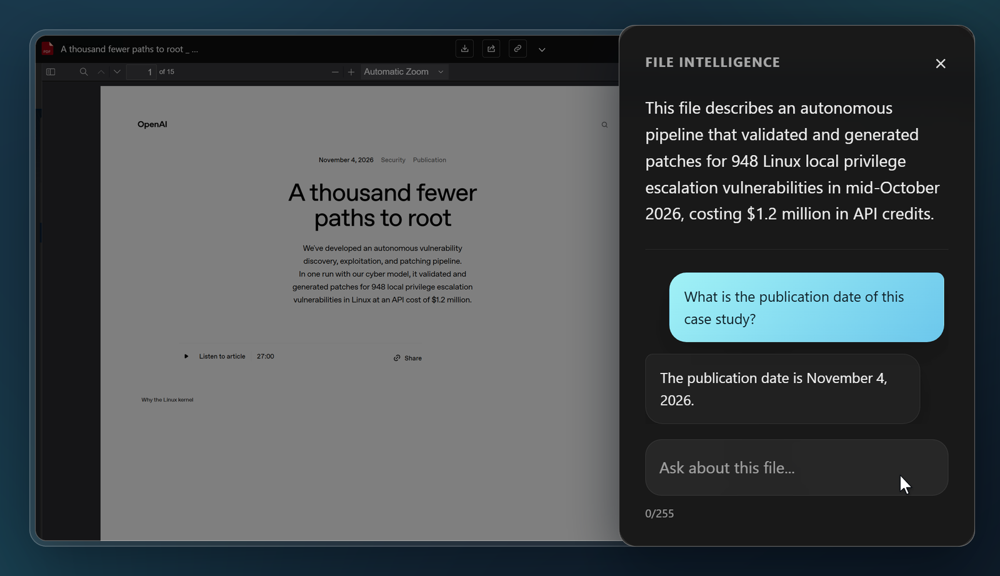

# File Q&A

File Q&A lets a user ask a question about the document they are looking at and get the answer in Salesforce, without reading the whole file.

It is most useful for the documents people open only to find one thing: contracts, statements of work, reports, requirements, proposals. *What is the notice period? Who signed it? When does it renew?*

## How users ask

1. Open a file in the **preview** window.
2. Open the AI side panel.
3. Type a question and send it.

The answer is based on the content of the open file. Users do not choose a model, a provider or a prompt. They ask in plain language.

## When it is available

Q&A appears when all of these are true:

- AI Analytics is on
- A provider is configured and validates successfully
- The file is in a format Google Client can analyze
- **Store files only** is off
- The user has access to the file

When any of these is not met, the question box is not shown.

There is one exception. A file analyzed while AI Analytics was on keeps its summary and labels, so its side panel can still be opened after an administrator turns AI Analytics off. The panel stays closed until the user opens it, and the question box is disabled with a note that questions are turned off. A question sent anyway is refused.

## What it will and will not answer

Answers come from the open document, and only from it. A question the document cannot answer gets a plain "I could not find that in this file" rather than a guess.

The assistant is not a search engine or a general chatbot. It reads one file and answers about that file.

Questions that try to pull the model away from the document, such as asking it to ignore its instructions, reveal its configuration or answer general knowledge, are refused before they reach the provider. See [AI Prompt Security](safety.md).

## Controlling the answers

Two administrator settings shape what comes back:

- **Question Prompt** sets how the provider is told to answer. The shipped prompt asks for accurate, concise, plain-text answers drawn only from the document, with a sensible attempt to match imperfect wording to the right table, column or section before giving up.
- **Question Max Output Tokens** sets how long an answer may be. Raising it allows fuller answers at a higher cost per question, and lowering it keeps answers short. A value of **0** lets the AI answer at any length.

📘 See [AI Intelligence settings](../../config/advanced/ai-intelligence.md) to change either.

## When the AI service is slow or busy

Google Client waits up to two minutes for an answer. If the AI service takes longer, the panel says the service took too long and asks the user to try again. If the service is busy, the panel says that instead. For any other problem it says the question could not be answered and suggests contacting an administrator. The technical detail goes to the logs and is never shown to the user.

A question is never tried again on its own. The person asking can simply ask again.

## Cost and expectations

Every question is a call to your AI provider and is billed by them. Answer length is the setting that moves that number most.

Answers are not stored. A question asked twice is a call made twice, and closing the preview ends the conversation.

 
