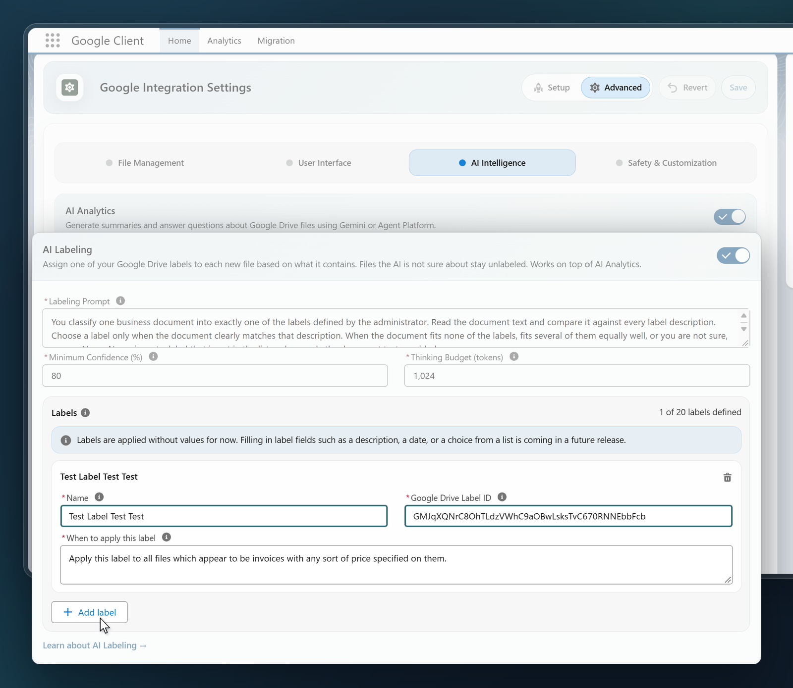
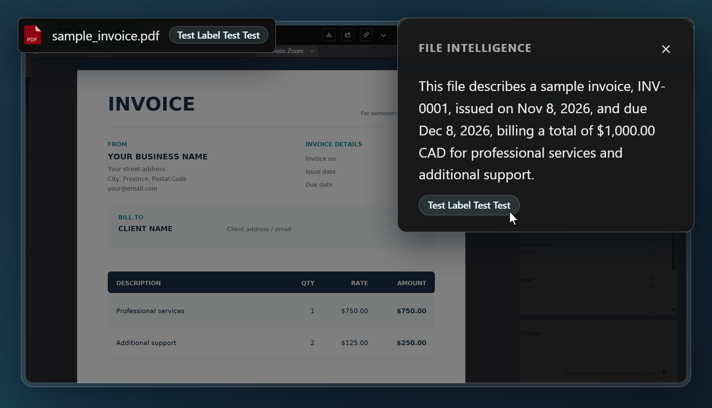
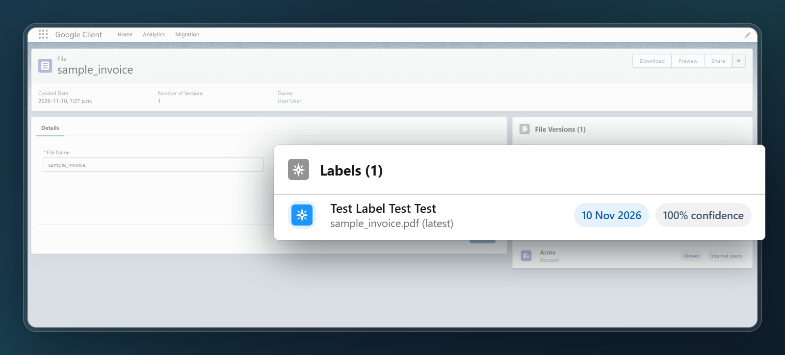

# File Labeling

File Labeling gives each new file one of your Google Drive labels based on what the file contains. You describe every label in plain language, Google Client compares each uploaded file with those descriptions and applies the best match. When it is not sure, the file stays unlabeled.

## What a label does

Google Drive labels are the metadata your organization already manages in the Google Admin console: a classification, a document type, a department, a retention class. When Google Client applies one, the file carries that label in Google Drive exactly as if a person had applied it, so Drive search, data protection rules and retention policies all see it. The Google Workspace copy that Google Client keeps for previews and analysis gets the same label, so both files are classified alike.

Every applied label is also recorded in Salesforce as a **Google File Version Label** related to the file version, with the label name, the Google Drive label ID and how confident the AI was. Those records are available in reports and to your own automation.

## Where labels appear

- In **Google Drive**, on the file and on its Google Workspace copy
- In the **preview** window, next to the file name and in the AI panel under the summary
- On the **File Details** page, in the **Labels** card, with the version it was applied to and how confident the AI was
- In **File Explorer**, through the **Labels** column an administrator can add, and in search, which matches label names
- In **reports**, through the Google File Version Labels related to each file version

Turning AI Analytics off later does not remove labels. They stay on the files in Google Drive and in Salesforce, and the preview's side panel can still be opened to see them.

## When a file is labeled

Labeling runs in the background after a file is uploaded or a new version is added, once the file has reached its folder and its summary has been made. Nobody waits for it.

The same files that can be summarized can be labeled: documents, spreadsheets, PDFs and images. A presentation, a video or an archive stays unlabeled, and nothing is labeled while **Store files only** is turned on.

Each version is labeled once and gets at most one label. A new version is labeled on its own merits, and Google Client never changes a label that is already on a version. Files uploaded before labeling was turned on are not labeled afterwards.

## Only when confident

For every file, the AI answers with the label it considers the best match and how sure it is, from 0 to 100. The label is applied only when that confidence reaches the **Minimum Confidence** you set. Below it, or when the AI answers that none of your labels fits, the file stays unlabeled. The default is 80.

## Setting it up

1. Create and publish the labels in Google Drive (Admin console → Apps → Google Workspace → Drive and Docs → Labels), and allow the service account used by Google Client to apply them.
2. Open the **Google Client** app → **Advanced** → **AI Intelligence**.
3. Turn on **AI Analytics** if it is not on yet, then turn on **AI Labeling**.
4. Select **Add label** and fill in the name, the Google Drive label ID and a description of the documents the label is for.
5. Save.

📘 See [AI Intelligence settings](../../config/advanced/ai-intelligence.md) for what each setting does.

### Finding the label ID

Open the label in the Google Admin console. Its ID is shown in the label details and in the page address. It never changes for the life of the label, so it only needs to be entered once.

### Label fields

Labels are applied without values. If a label has fields, such as a description, a date or a choice from a list, they stay empty and can be filled in by hand in Google Drive.

## Label descriptions

The AI picks a label by comparing the document with each description, so a description says what the document is, what it usually contains and, where two labels are easy to confuse, what it is not:

- *Invoice*: "A bill requesting payment for goods or services. Usually has an invoice number, line items with amounts, a total, and a due date. Not a quote or a purchase order."
- *Contract*: "An agreement between two or more parties with obligations, terms, and signatures or signature blocks. Includes NDAs, master service agreements, and statements of work."

## Cost and expectations

Each labeled file is one more call to your AI provider, on top of the summary, and is billed by them. The **Thinking Budget** gives the AI room to reason before it decides. The default of 1024 suits models that keep reasoning whatever they are told, which would otherwise answer with nothing, and 0 makes calls faster and cheaper where the model allows it.

## When a file cannot be labeled

When the AI service is slow or busy, Google Client tries the file again on its own, twice over the next few minutes, as it does for summaries. A label Google Drive refuses is not tried again, because Drive would refuse it the same way.

Nothing breaks. If the provider is not configured, the file cannot be analyzed, Google Drive refuses the label or every attempt fails, the file simply has no label and every other part of Google Client keeps working. The reason is recorded in the logs, and administrators see it on the Analytics dashboard.

## Privacy

Labeling sends the document content to the AI provider you configured, and to no one else. The request passes through the same protections as a summary or a user question. See [AI Prompt Security](safety.md).

 
