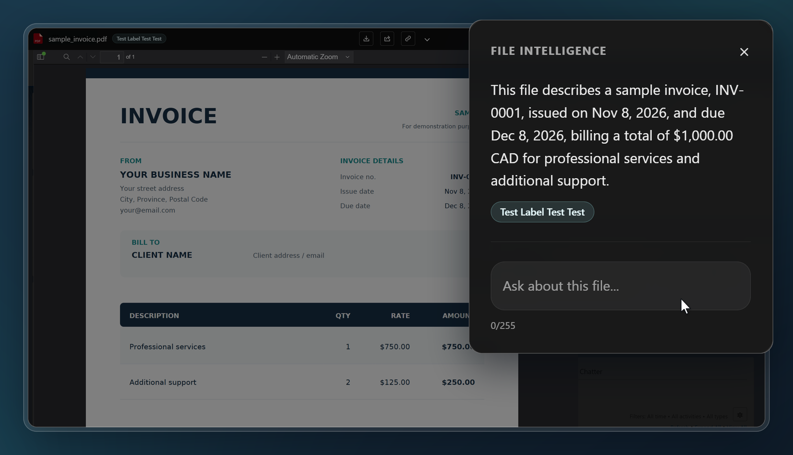

# AI & Intelligence

Google Client includes an optional AI layer that helps people understand documents without leaving Salesforce, and often without opening them at all.

It does three things: it writes a short summary of every file, it answers questions about the file a user is looking at, and it can label each new file with one of your Google Drive labels.

## What it adds

- **[Document Summaries](summaries.md)**

    A short description of what each file contains, written in the background and stored in Salesforce, so users can tell files apart from a list.

- **[File Q&A](file-qa.md)**

    Ask a question about the open document and get the answer in the preview window, instead of reading the whole file to find one clause.

- **[File Labeling](labeling.md)**

    Describe each Google Drive label in plain language and let Google Client apply the best match to every new file, or leave the file unlabeled when it is not sure.

## How it works

Google Client analyzes the Google Workspace copy of a file rather than the original upload, which is how a Word document, a spreadsheet and a PDF can all be handled the same way. The original file in Google Drive is never modified. Because AI reads that copy, it is not available while **Store files only** is turned on under **Advanced** → **File Management**.

Summaries and labels are made in the background after an upload, so nobody waits for them. When the AI service is slow or busy, Google Client tries again on its own a few minutes later. Questions are answered on demand while the preview is open.

Everything goes to the AI provider **you** configure, in **your** Google account, and nowhere else. Google Client runs no model of its own and does not route content through any third party.

## What is protected

Every question is inspected before it leaves Salesforce, and every answer before it is shown. That guards against attempts to talk the model out of its instructions, such as asking it to ignore its rules, reveal its configuration or answer about something other than the open file, and against answers that leak a credential or invent personal data.

The protection is on from the moment AI Analytics is turned on, at **Standard** strictness. It can be tightened, loosened or replaced with your own Apex implementation.

📘 See [AI Prompt Security](safety.md) for the modes and how to bring your own.

## Choosing a provider

| | Gemini Developer API | Agent Platform |
|---|---|---|
| **Authentication** | An API key from Google AI Studio | The service account already used for Google Drive |
| **Google Cloud project** | Not required | Required, with billing active |
| **Best for** | Development, sandboxes, internal evaluation | UAT and production |

Both provide the same features. Agent Platform keeps AI usage under the same Google Cloud project, billing and audit as the rest of the integration.

## It is optional

The core Google Drive experience does not depend on AI. Upload, preview, download, sharing, public links, folder structure, file reuse and versioning all work exactly the same when AI Analytics is off or was never configured. The AI controls are simply not shown.

## Where to go next

- [Configure AI & Intelligence](../../setup/configure-intelligence.md) to connect a provider
- [AI Intelligence settings](../../config/advanced/ai-intelligence.md) for prompts, the length of summaries and answers, and labeling
- [Safety & Customization](../../config/advanced/safety-customization.md) for the safety mode

 
