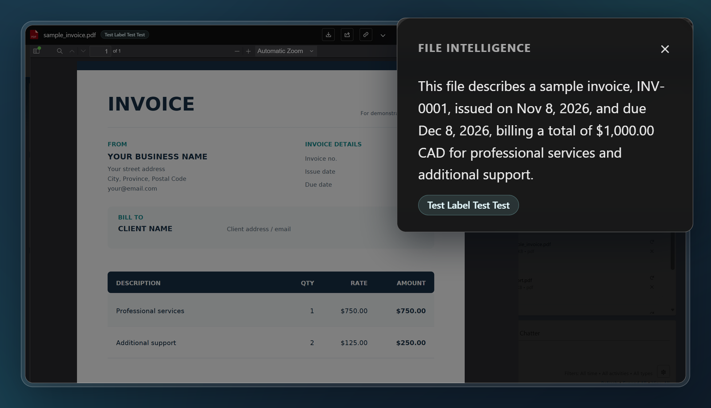

# Document Summaries

A summary is a short, business-facing description of what a file contains. It is written once, stored in Salesforce on the file version, and shown wherever someone needs to know what a document is without opening it.

## Where summaries appear

- In the **preview** window, in the side panel next to the document
- When hovering over a file in Notes & Attachments and the Uploader, where the file name alone is not enough to tell files apart
- In **File Explorer**, through the Summary column an administrator can add, and in search
- In list views, reports and your own components, because the summary is stored on the file version like any other Salesforce field

## When a summary is made

A summary is made in the background after a file is uploaded or a new version is added. Nobody waits for it, and the AI panel in the preview shows it as soon as it arrives.

Every new version gets its own summary. The summary describes that specific version, so replacing a contract with a revised copy gives you a summary of the revision, not of the original.

Documents, spreadsheets, PDFs and images are summarized, while a presentation, a video or an archive is not. No summaries are made while **Store files only** is turned on.

## Controlling the wording and length

The summary prompt is an administrator setting. The shipped prompt asks for a very short summary beginning with "This file describes", focused on the main subject and the most important names, dates and numbers. A stored summary is at most 255 characters long, whatever the prompt asks for.

📘 See [AI Intelligence settings](../../config/advanced/ai-intelligence.md) to change the prompt or the **Summary Max Output Tokens**.

## When the AI service is slow or busy

When a summary cannot be made because the service took too long or was busy, Google Client tries again on its own, twice over the next few minutes. Files uploaded together do not wait for each other: the ones that worked are saved straight away.

Meanwhile the preview says the file is still being analyzed, and the summary appears as soon as an attempt works.

## When a summary cannot be made

Nothing breaks. If the provider is not configured, the file cannot be analyzed or every attempt fails, the file simply has no summary and every other part of Google Client keeps working. Users see the file exactly as they would with AI Analytics off.

A file that is given up on is recorded in the logs with the reason, and administrators see it on the Analytics dashboard.

## Privacy

Making a summary sends the document content to the AI provider you configured, and to no one else. The request passes through the same protections as a user question. See [AI Prompt Security](safety.md).

 
