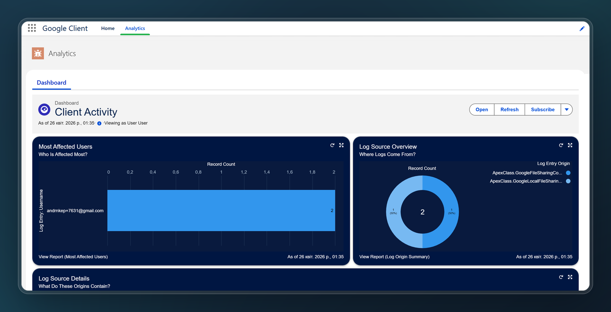

# Audit & Logging

Google Client gives administrators visibility into what goes wrong with files inside Salesforce, and Google Workspace keeps its own record of what happens in Google Drive.

## Salesforce logs

Google Client records failures through [**Nebula Logger**](https://github.com/jongpie/NebulaLogger){ target="_blank" rel="noopener noreferrer" }, tagged `Google Client for Salesforce` so its entries stand out in a shared org. The logs are stored inside Salesforce and need no third-party tooling.

The logs keep only what went wrong. When an upload, a background step or an AI request fails, the log is saved with every line of that run, so you see everything that led up to the failure. A run that succeeds saves nothing, and an attempt that Google Client will try again later is not saved as a failure.

A few events are saved even though nothing failed, because administrators need to see them:

- The AI safety check blocking a question or an answer, or hiding a stored summary
- A migration being started or stopped
- The outcome of a direct browser upload

## Analytics tab

The **Google Client** app has an **Analytics** tab with a built-in Salesforce dashboard. It gives administrators a quick view of errors and activity based on the logs, without leaving the app.

## Google Workspace audit

On the Google side, file activity is tracked by Google Workspace itself. The **Drive audit log** in the **Google Admin console** shows who opened files, sharing changes and security alerts.

 
