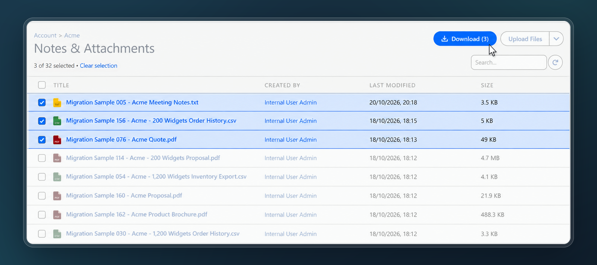
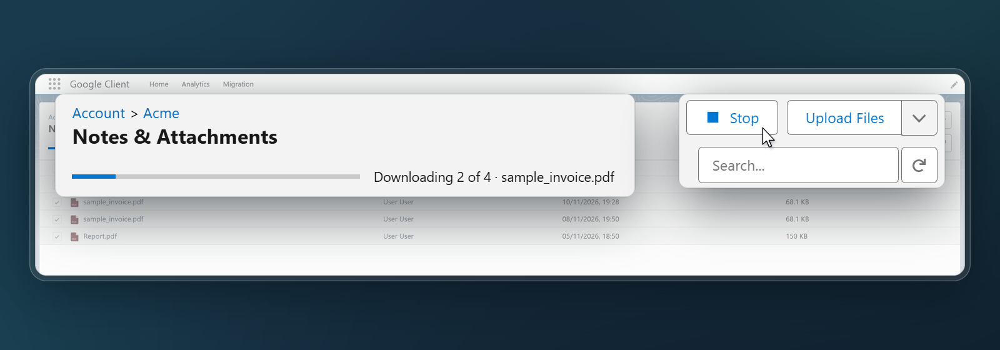
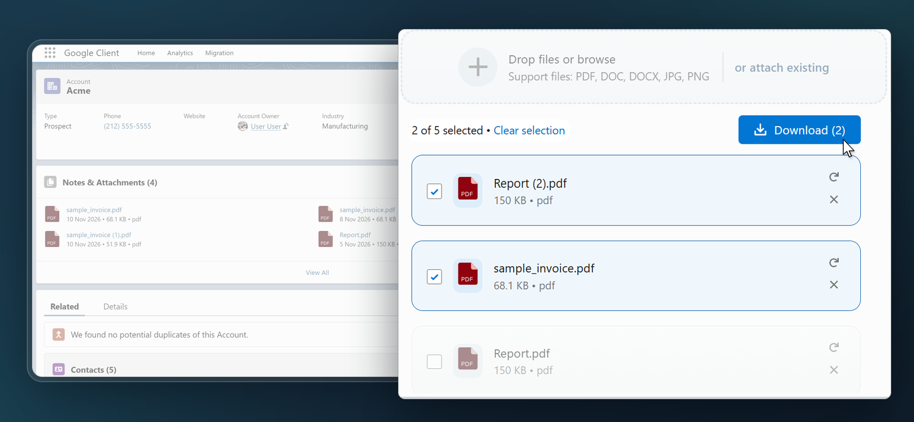
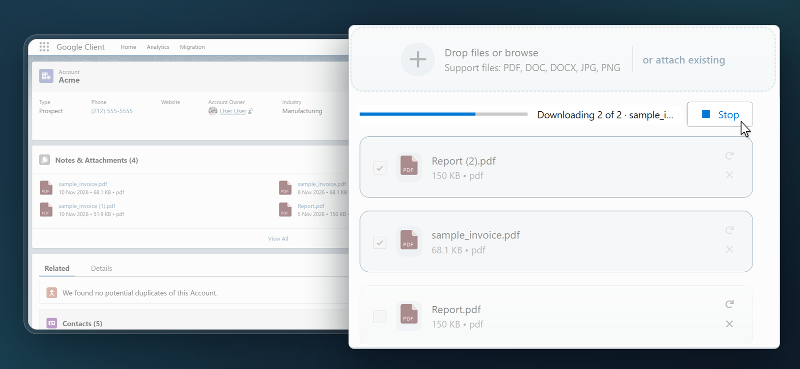
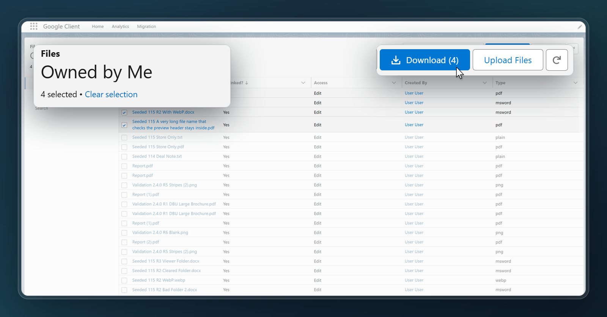
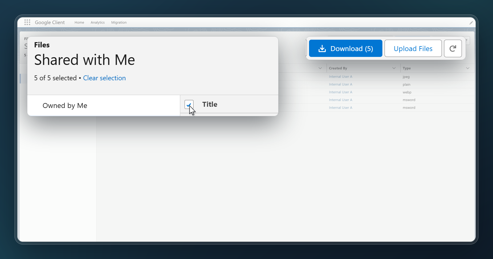
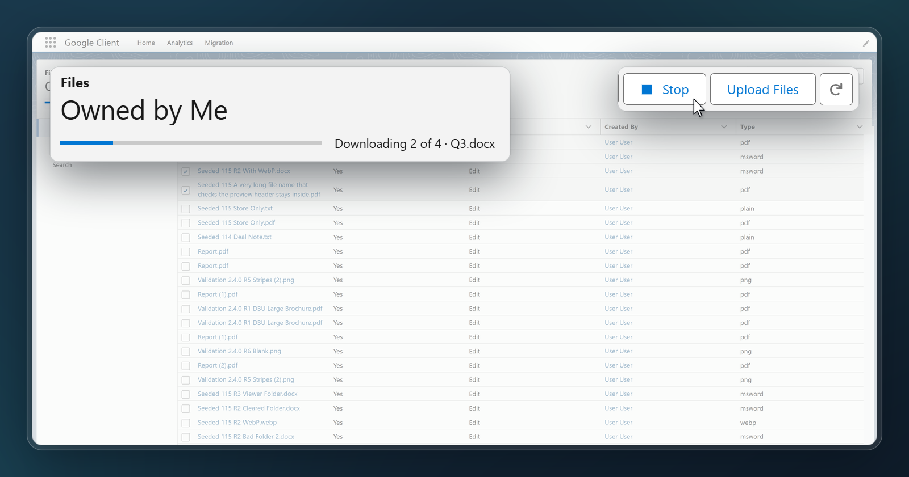

# Bulk Download

Pick several files and download them together as one ZIP archive. It works on the **View All** page of Notes & Attachments, in the Uploader and in every view of File Explorer, on record pages, Experience Cloud sites and Screen Flows alike.

## How it works

1. Tick the files you want.
2. Select **Download (N)**, which appears as soon as one file is ticked.
3. A progress bar shows which file is being fetched. **Stop** cancels the download, and nothing is saved.
4. Your browser saves the archive, named after the record, such as `Acme Corporation - 3 files.zip`, or `Files - 3 files.zip` where there is no record name to use.

**Clear selection** unticks everything.

## Notes & Attachments

On a record, open Notes & Attachments and click **View All**. The checkbox in the column header ticks every file shown, searching keeps your selection, and **Download (N)** sits next to **Upload Files**.

## Uploader

Each uploaded file has a checkbox in front of its icon, and **Download (N)** appears above the list. While the download runs, the selected files cannot be opened, replaced or removed, and leaving the page or moving to the next screen of a Flow stops it.

## File Explorer

The checkbox in the column header ticks every file loaded so far, **Download (N)** sits next to **Upload Files**, and the archive is named `Files - N files.zip`.

The download runs in the background, so you can keep searching, switching views and opening files. It takes the files ticked when it started, and files a new search no longer lists are unticked.

## What to expect

- Each file is included under its own name with its current version, and two files with the same name are numbered, such as `Report (2).pdf`.
- Only files you can open are offered, and each one is checked again when it is fetched.
- A file that cannot be fetched is left out of the archive, named in the message afterwards and left selected.
- Up to 100 files and 512 MB go in one archive.

 
