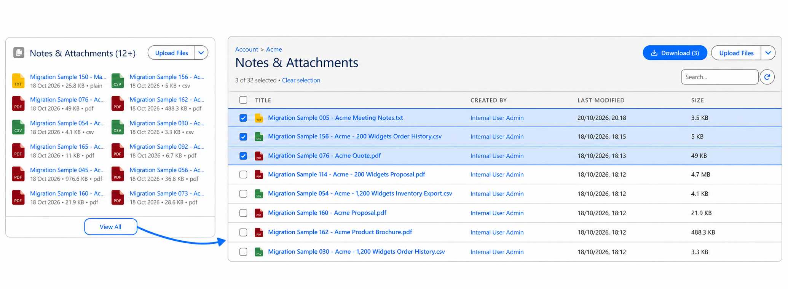
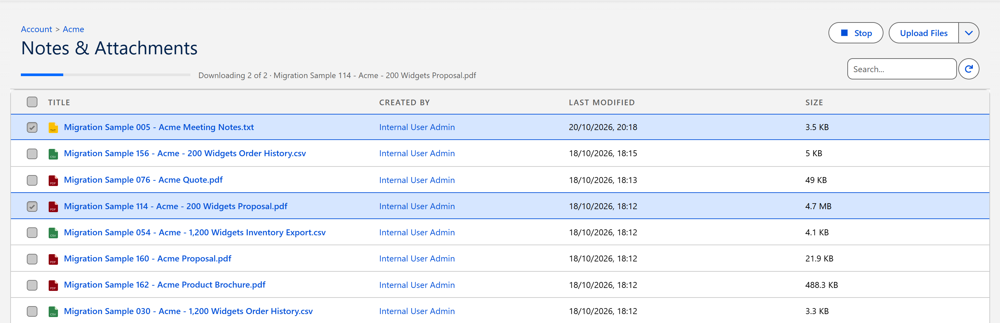

# Bulk Download

Bulk download lets you pick several files and download them together as one ZIP archive, instead of opening and downloading each file on its own.

| Where | Available |
|---|---|
| Notes & Attachments, **View All** page | Yes |
| File Explorer | In the next release |
| Uploader | In the next release |

## Notes & Attachments

The **View All** page of Notes & Attachments lets you pick several files of a record and download them together.

### How it works

1. On a record, open the Notes & Attachments component and click **View All**.
2. Tick the files you want. The checkbox in the column header selects every file shown, and the search box narrows the list while your selection is kept.
3. Click **Download (N)** next to **Upload Files**. The button appears as soon as one file is ticked and shows how many are selected.
4. Watch the progress bar. It says which file is being fetched and how far the download has got.
5. The archive is saved by your browser like any other download, named after the record, for example `Acme Corporation - 3 files.zip`.

**Clear selection** unticks everything, and **Stop** cancels a download that is running. A stopped download saves nothing.

The View All page of an Experience Cloud site offers the same checkboxes and the same **Download** button.

## File Explorer

Bulk download from [File Explorer](file-explorer.md) will be delivered in the next release.

## Uploader

Bulk download from the Uploader component will be delivered in the next release.

## What is in the archive

- Each file is included under its own name, with its current version. Two files with the same name are numbered, for example `Report.pdf` and `Report (2).pdf`.
- Files are stored as they are, without compression, so the archive is about as large as the files themselves.
- The archive opens with the tools built into Windows and macOS and with common archive programs.

## Things worth knowing

- **You download what you can open.** Only files you have access to are offered, and every file is checked again when it is fetched, so a bulk download never includes a file you could not open on your own.
- **A file that cannot be fetched is left out.** The others are still saved, the message after the download names the file that is missing, and it stays selected so you can try it again.
- **Up to 100 files and 512 MB at a time.** A larger selection is refused with a message asking you to select fewer files, and nothing is downloaded.
- **Large files take longer.** A file bigger than what one request can carry is fetched in pieces, and the progress bar moves with them.

 
