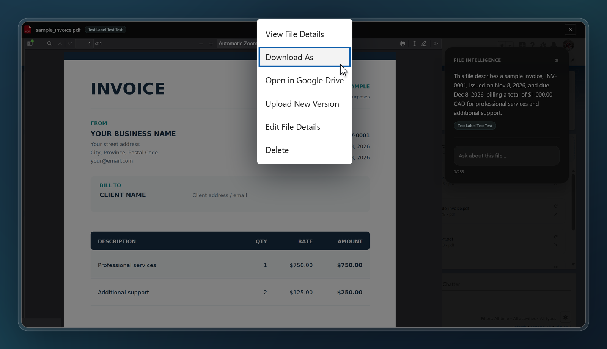
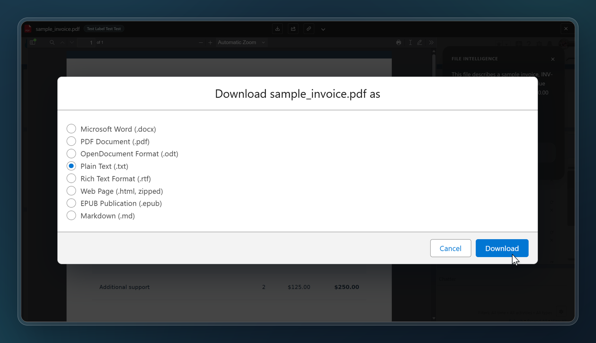

# Download As

**Download As** saves a file in another format straight from the preview, such as a Word document as a PDF or a CSV file as an Excel workbook, without opening Google Drive.

## How to use it

1. Open the file in the preview.
2. Open the **More** menu (the arrow beside **Public Link**) and select **Download As**.
3. Pick a format and select **Download**.

The file is saved under its own name with the new extension. The original in Google Drive does not change.

## Formats

| File | Can be saved as |
|---|---|
| Word documents, PDFs and images (PNG, JPEG, GIF, BMP) | Microsoft Word (.docx), PDF, OpenDocument (.odt), plain text (.txt), rich text (.rtf), web page (.html, zipped), EPUB (.epub), Markdown (.md) |
| Excel workbooks, CSV files and Google Sheets | Microsoft Excel (.xlsx), OpenDocument (.ods), PDF, web page (.html, zipped), CSV, TSV |

A spreadsheet saved as CSV or TSV holds its first sheet only.

## When it is offered

Download As converts the Google Workspace copy Google Client keeps of each file, so the menu offers it only when that copy is there. It is not offered:

- right after an upload, for the minute or two it takes to make the copy
- while **Store files only** is on, or for a file uploaded while it was on
- for a file larger than the **Maximum Preview File Size** setting
- for any other type, such as presentations, videos or archives

Anyone who can open the file can use it.

📘 See [Advanced: File Management](../config/advanced/file-management.md)

 
