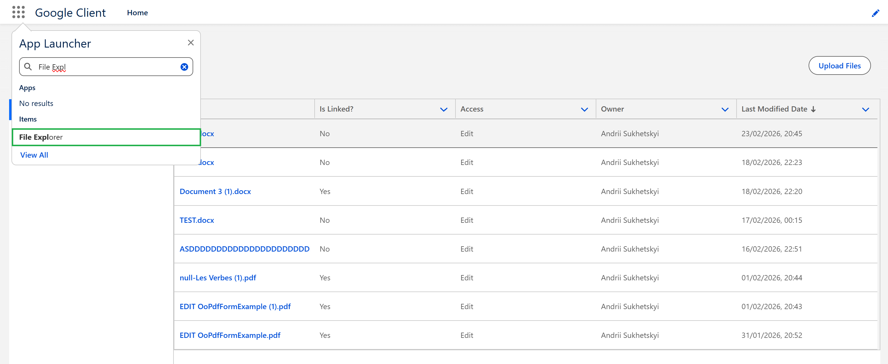

# File Explorer

The **File Explorer** is a Lightning tab that lets users browse Google Drive files from Salesforce in a clean and fast User Interface.

## How to Open It

1. In Salesforce, go to **App Launcher**
2. Search for **File Explorer**
3. Open the tab

To see the tab, the user must have the permission set **Google Cloud Client User**.

## What This Tab Contains

The File Explorer has three views:

- **Owned by Me** — files you own in Salesforce
- **Shared with Me** — files shared with you (primarily via direct user/group sharing)
- **Search** — every file you can open, narrowed by words and filters

Users with the **Google Client: View All Files** or **Google Client: Edit All Files** permission see **All Files** and **Search** instead.

Every view lists only files you can open, and an empty view says so instead of showing a blank list.

## File List Columns

By default, the table shows your accessible files with key details such as:

- **Title**
- **Is Linked?** — whether the file is linked (assigned) to a Salesforce record
- **Access** — your effective access level (View/Edit)
- **Owner**
- **Last Modified Date**

### Configuring Columns

Administrators can tailor which columns appear, and in what order, from the **Google Client** app → setup wizard → **Advanced → User Interface**.

- Pick columns from the built-in catalog — **Title**, **Type**, **Size**, **Created By**, **Owner**, **Created Date**, **Last Modified Date**, **Is Linked?**, **Access**, **Summary** (the AI-generated file summary), and **Labels** (the Google Drive labels applied by AI) — and drag to reorder them.
- **Title** is always displayed first and cannot be removed, because it is the link users click to preview a file.
- A maximum of **7** columns can be displayed.

Need a field that isn't in the catalog? Enter any **Google File Version** field API name (for example, `Summary__c`) in the **Add a custom field** box. Custom entries are **not** validated when you save — enter the exact API name. If the field does not exist or cannot be read, its column simply appears empty instead of causing an error.

📘 See [Advanced: User Interface](../config/advanced/user-interface.md) for the full column list and what can be sorted.

## Searching Files

Use the **Search** box in the File Explorer header to filter the current view. The search matches on the **file name** and, when present, the file's **Summary** and its **Labels** — so you can find a document by what it contains, or by the label the AI applied to it, even if you do not remember its exact name. Files without a summary or labels continue to match by name.

To search across every file you can open, or to narrow the list by type, size, date and more, use the **Search** view below.

Beyond the File Explorer, Google Files can also be found through Salesforce **global search**. Opening a file from a global search result takes you straight to its **File Details** page. Global search follows Salesforce's standard sharing (files you own or that are directly shared with you), while the File Explorer also shows files you can reach through record-based access.

## Search

Select **Search** in the left navigation to find files across everything you can open. With nothing entered, it lists all of them. The results update by themselves a moment after you stop typing or change a filter.

<!-- IMAGE: file_explorer_search.png — the Search view with a few words typed, the File type and Created filters in use, and matching files listed -->

### Key Phrases

Type words from a file's name, its AI summary or its labels into the search box at the top.

- Every word must appear, in any order and in any of the three. Case does not matter.
- Put words in double quotes to find them only as a whole, for example `"contract renewal"`.
- Summaries and labels the AI already added are searched even if AI is turned off later.
- Up to 10 words or phrases count; anything after them is ignored.

### Filters

Below the search box, each filter opens a short list of choices. A filter in use is highlighted and shows what it is set to; its **✕** removes it. A file must match every filter in use.

| Filter | Choices |
|---|---|
| **File type** | PDF, Word documents, Spreadsheets, Presentations, Images, Text, Video, Audio, Archives. Several can be chosen at once. |
| **Size** | Smaller than 1 MB, 1 MB to 10 MB, 10 MB to 100 MB, Larger than 100 MB |
| **Created** | Today, Last 7 days, Last 30 days, This year, Last year, or a custom range of days |
| **Last modified** | The same choices as **Created** |
| **Versions** | Only one, 2 or more, 5 or more, 10 or more |
| **Owner** | Me, or the name of anyone who owns files you can open. This is the file's owner, not the person who uploaded it. |
| **Linked** | Yes for files linked to at least one record, No for files linked to none |

- Sizes and dates are those of the file's current version and of the file itself: **Last 7 days** and **Last 30 days** include today, and a custom range includes both its first and its last day. A custom range applies once both its days are chosen.
- Uploading a new version, editing the file's details or linking it to a record counts as a change for **Last modified**.
- **Owner** lists only people and queues whose files you can open, up to 200 names. If you can open a very large number of files, someone whose files have all gone a long time without a change may not be listed.
- Looking for a type the **File type** filter does not list? Type its extension into the search box, for example `.dwg`, since the file name is searched.

**Clear all** resets the words and every filter at once.

### Results

The line under the title says what was found, for example **12 files match** or **50+ files match** while more files load as you scroll. The list can be sorted by the same columns as the other views.

If nothing matches, the view says so and offers **Clear all**. Leaving File Explorer and coming back in the same browser session reopens Search with what you had entered.

## Downloading Several Files

In every view, tick the files you want and select **Download** to save them as one ZIP archive. The header checkbox ticks every file loaded so far.

<!-- IMAGE: file_explorer_search_download.png — three files ticked in Search, the selection line under the title and Download (3) beside Upload Files -->

- The download runs in the background: you can keep searching, scrolling, sorting and opening files while the progress stays in the header, and **Stop** cancels it.
- It downloads the files that were ticked when it started. Files you tick meanwhile stay ticked afterwards.
- Up to 100 files and 512 MB can be downloaded together.

📘 See [Bulk Download](bulk-download.md) for how the archive is named and what happens when a file cannot be included.

## Loading Large File Lists

The file list loads **progressively**: an initial set of rows is shown right away, and more rows are appended automatically as you scroll toward the bottom of the table. This keeps the tab responsive when you have access to a large number of files. Searching, filtering, and sorting always apply across **all** of your files.

Administrators with the **Google Client: View All Files** or **Google Client: Edit All Files** permission browse **all** Google Files here, in an **All Files** view next to **Search**, instead of **Owned by Me** and **Shared with Me**. Everyone else sees only the files they can actually reach.

Either way the list is paged, and search and sorting run across all of your files rather than only the rows already loaded — so the tab behaves the same in an org with fifty files and an org with fifty thousand.

## Uploading Files from File Explorer

You can upload files using **Upload Files**. However, any file uploaded from this tab will be **not linked to any Salesforce record** (**Is Linked? = No**).

 