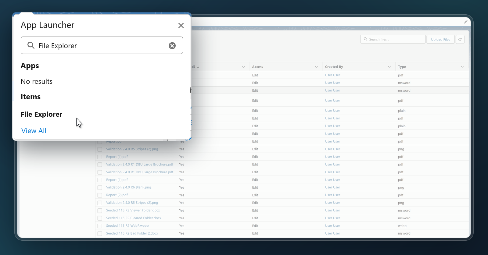
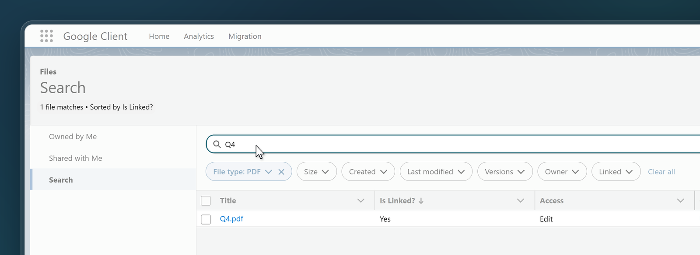
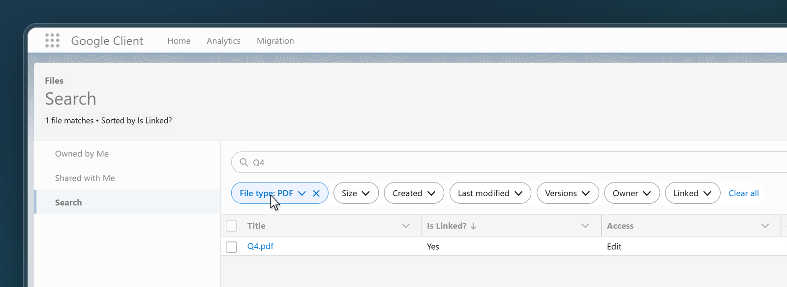

# File Explorer

The **File Explorer** tab lists every Google Client file you can open, in one place. Browse it, search it and open any file in the preview.

## How to open it

Open the **App Launcher**, search for **File Explorer** and open the tab. It needs the **Google Cloud Client User** permission set.

## Views

| View | What it lists |
|---|---|
| **Owned by Me** | Files you own |
| **Shared with Me** | Files someone else owns that you can open, whether shared with you directly or through a record |
| **Search** | Every file you can open, narrowed by words and filters |

With the **Google Client: View All Files** or **Google Client: Edit All Files** permission, the views are **All Files**, which lists every Google File in the org, and **Search**.

Every view lists only the files you can open, and loads more as you scroll.

## Columns

By default the list shows **Title**, **Is Linked?**, **Access**, **Created By** and **Last Modified Date**. **Title** always comes first and opens the preview. Your administrator chooses the rest.

📘 See [Advanced: User Interface](../config/advanced/user-interface.md)

## Quick search

In **Owned by Me**, **Shared with Me** and **All Files**, the **Search files...** box in the header narrows the view you are in. It matches the file name, its AI summary and its labels, so a document can be found by what it is about.

## Search

The **Search** view looks across every file you can open. With nothing entered it lists all of them, and the list updates a moment after you stop typing or change a filter.

### Key phrases

Type words from a file's name, its AI summary or its labels. Every word must appear, in any order and any case. Put words in double quotes, such as `"contract renewal"`, to match them only together. Up to 10 words or phrases count.

### Filters

Each filter below the box opens a short list of choices. A file must match every filter in use, **✕** removes one filter and **Clear all** removes everything.

| Filter | Choices |
|---|---|
| **File type** | PDF, Word documents, Spreadsheets, Presentations, Images, Text, Video, Audio, Archives. Several can be chosen at once. |
| **Size** | Smaller than 1 MB, 1 MB to 10 MB, 10 MB to 100 MB, Larger than 100 MB |
| **Created** | Today, Last 7 days, Last 30 days, This year, Last year, or a custom range of days |
| **Last modified** | The same choices as **Created** |
| **Versions** | Only one, 2 or more, 5 or more, 10 or more |
| **Owner** | Me, or anyone who owns files you can open. This is the file's owner, not the person who uploaded it. |
| **Linked** | Yes for files linked to at least one record, No for files linked to none |

- A custom date range includes its first and last day, and applies once both are chosen.
- A new version, edited file details or a new link to a record count as a change for **Last modified**.
- **Owner** lists up to 200 names. With a very large number of files, someone whose files have not changed in a long time may be missing.
- A type the **File type** filter does not list can be found by its extension in the box, such as `.dwg`.

 