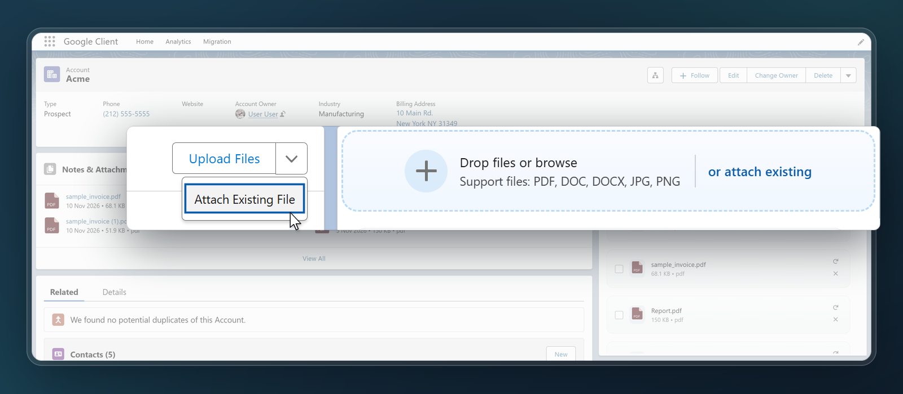
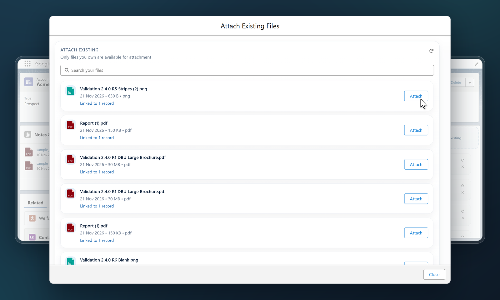
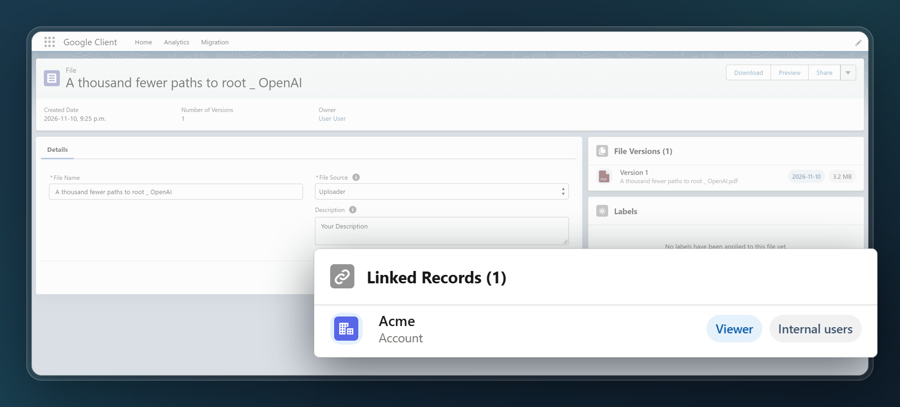

# File Reuse & Linked Records

Google Client lets users attach an existing Google Client file to more than one Salesforce record. The file stays a single Google Drive file and a single Google Client file, while Salesforce keeps a separate link for each record it belongs to.

This is useful when the same document belongs to several records, for example a contract connected to an Account and an Opportunity, a specification reused across Cases, or an approval document tied to more than one custom record.

## What users can do

From the record components, users can:

- Upload a new file to Google Drive for the current record
- Attach one of their existing Google Client files to the current record
- Reuse the same file across several records without uploading duplicate copies
- Open the file details page and see the records the file is linked to
- Preview, download, share and version the file in the same Salesforce screens

## Where it is available

Attach Existing File is offered wherever files are shown for a record:

- **Google Client: Attachments**
- **Google Client: Uploader**
- The **View All** page of Notes & Attachments

It needs a record to attach to. A file uploaded from File Explorer stands on its own until it is attached to a record.

## Ownership boundary

The Attach Existing Files selector shows the files the current user owns.

This keeps ownership predictable. A user can reuse their own Google Client files, but cannot take someone else's file and attach it to an unrelated record this way.

Google Client also checks that the user can read the target record before the file is attached to it.

## How linked records work

When a file is attached to a Salesforce record, Google Client creates a file link for that record. In 2.0.0, a file can have more than one valid record link.

The result is simple:

- The Google Drive file is not duplicated
- The Google Client file is not duplicated
- Each Salesforce record gets its own link to the same file
- Each link can give access to the file
- File details show the records linked to the file, limited to the records the current user can see

## Access

Each linked record can give access to the file, but only when the current user has the required access to that record and the file link grants access through its Share Type.

If a file is linked to Record A and Record B, a user with access to Record A can open the file through Record A. A user with access only to an unrelated Record C cannot see or act on the file through that record.

📘 See [Security & Access Model](../security.md) for the full access rules.

## Deleting a file

When a Google Client file is deleted, Google Client removes its links to every record, so a deleted file never keeps appearing through an old link.

 
