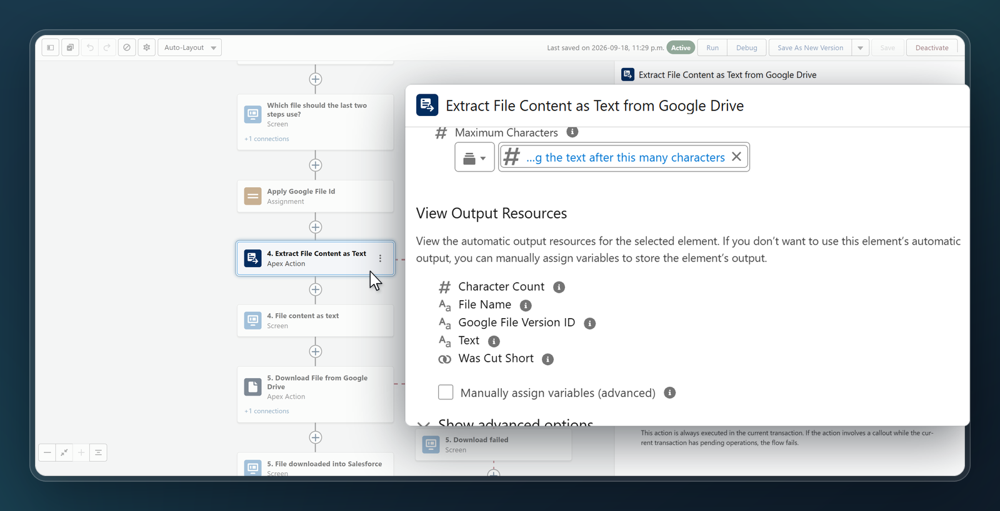
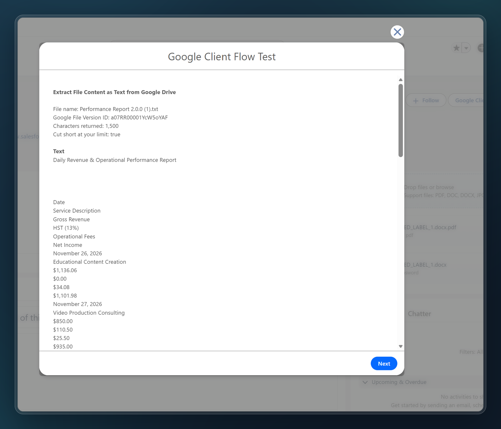

# Extract File Content as Text from Google Drive

**Type:** Action, listed under the **Google Client** category in Flow Builder.

Reads the content of a Google Client file as plain text, so the rest of the flow can work with what the file actually says.

## When to use it

- Feed a document into a prompt template so a model can answer questions about it.
- Check whether a file contains specific wording before the flow continues.
- Copy part of a document onto a record field.

## How to add it to a flow

1. Open **Flow Builder** in Salesforce Setup.
2. Create a flow, or open an existing one.
3. Add an **Action** element.
4. Choose the **Google Client** category and select **Extract File Content as Text from Google Drive**.
5. Set either **Google File ID** or **Google File Version ID**.
6. Set **Maximum Characters** if you only need the beginning of the file.
7. Save and activate the flow.

## Inputs

| Input | Required | Description |
|---|---|---|
| **Google File Version ID** | One of the two | The exact version to read. |
| **Google File ID** | One of the two | The file whose latest version is read when no version is given. |
| **Maximum Characters** | No | Cuts the text after this many characters. Leave blank to return everything. |

## Outputs

| Output | Description |
|---|---|
| **Text** | The file content as plain text |
| **Character Count** | How many characters were returned |
| **Was Cut Short** | True when the text was cut at Maximum Characters |
| **Google File Version ID**, **File Name** | The version that was read |

## Which files can be read

Text comes from the Google Workspace copy that Google Client prepares for documents, spreadsheets, PDFs and images, so every file type that can be previewed can also be read.

Plain text files such as `.txt`, `.csv` and `.md` are read straight from the upload and are ready the moment the file arrives.

While **Store files only** is turned on under **Advanced** → **File Management**, only plain text files can be read. Every other file, including one that already has a Google Workspace copy, fails with "Text is not available for this file while file previews are turned off.", which a **Fault** path can catch.

## When text is not ready yet

For a file uploaded moments earlier, the Google Workspace copy may still be in preparation. The action then reports that the text is not available yet, not that the file is empty. A file uploaded longer ago that has no copy reports that its text is not available.

A flow that uploads a file and reads it straight away usually gets this answer, while a record triggered flow on an **asynchronous path** usually finds the copy ready.

**Maximum Characters** keeps a long text within what one flow element can hold, and **Was Cut Short** says whether anything was left out.

 