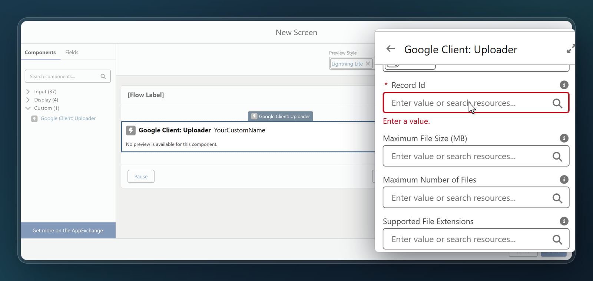

# Uploader in Screen Flows

**Type:** Screen element, listed as **Google Client: Uploader** in Flow Builder.

The Google Client Uploader can be placed directly inside a Salesforce **Screen Flow**, so you can collect files as part of any guided process, such as a case intake form, an onboarding checklist or a document submission step, without writing code.

Files uploaded through the flow go straight to Google Drive and are linked to the record you specify, just like any other upload in Google Client.

## How to add it to a flow

1. Open **Flow Builder** in Salesforce Setup.
2. Create a new Screen Flow, or open an existing one.
3. Add a **Screen** element to your flow.
4. Inside the screen, search for **Google Client: Uploader** in the component list and add it.
5. Set the **Record Id** property, which tells the component which record the uploaded files are linked to. In most cases you pass a flow variable or the `{!recordId}` of the record the flow runs on.
6. Set any of the optional limits below.
7. Save and activate the flow.

## Component properties

| Property | Required | Description |
|---|---|---|
| **Record Id** | Yes | The Salesforce record the uploaded files are linked to. |
| **Supported File Extensions** | No | Comma-separated list of allowed extensions, for example `PDF, DOCX, PNG`. Leave blank to allow every type. |
| **Maximum File Size (MB)** | No | Files above this size are refused. Leave blank for no limit. |
| **Allow Multiple Files?** | Yes | `true` lets users upload several files at once, `false` allows one at a time. Defaults to `true`. |
| **Maximum Number of Files** | No | Limits how many files a user can upload. Leave blank for no limit. |

## What happens after upload

Each file goes to Google Drive as soon as it is uploaded and is linked to the record. The user sees the file listed in the Uploader and can preview it or delete it before moving to the next screen. They can also tick several files and [download them together](../bulk-download.md) as one ZIP archive, and moving to the next screen while that download runs stops it. The same access rules and folder structure apply here as everywhere else in Google Client.

## Automating without a screen

The Uploader collects files from a person. To move files around with nobody at the screen, use the actions instead.

📘 [Create Folder in Google Drive](create-folder-action.md)

📘 [Upload File to Google Drive](upload-file-action.md)

📘 [Download File from Google Drive](download-file-action.md)

📘 [Extract File Content as Text from Google Drive](extract-text-action.md)

📘 [Check Access to a Google File](check-access-action.md)

 
