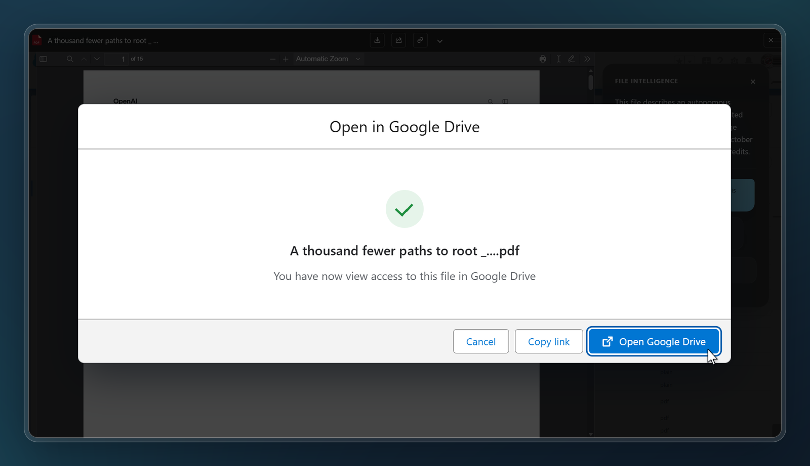

# Open in Google Drive

File owners can open a file directly in Google Drive, to view it there, print it or keep their own copy, without looking it up themselves.

!!! note
    This is **off by default**. An administrator turns it on under [**Advanced** → **File Management**](../config/advanced/file-management.md).

## Who can use it

Only the **owner** of a file can open it in Google Drive, and only an internal Salesforce user. Everyone else, including the people the file is shared with and Experience Cloud users, does not see the option at all.

Files owned by a queue or a group do not offer it, because there is no single person to give access to.

## How it works

1. Open a file in the preview window, or on its **File Details** page.
2. Choose **Open in Google Drive** from the menu.
3. A window confirms your access is ready.
4. Click **Open Google Drive**, and the file opens in a new browser tab.

The first time you open a file it takes a moment while access is arranged. After that it is faster.

## What you can do in Google Drive

You get **view access** to that one file. Where your Google Drive supports timed access, it ends automatically after a week, and opening the file again extends it. Where it does not, access stays until it is removed in Google Drive.

| You can | You cannot |
|---|---|
| View the file | Change it |
| Print it | Delete it |
| Download it | Share it with anyone else |
| Save your own copy to your Drive | Open the folder it lives in, or see anything else in it |

 
