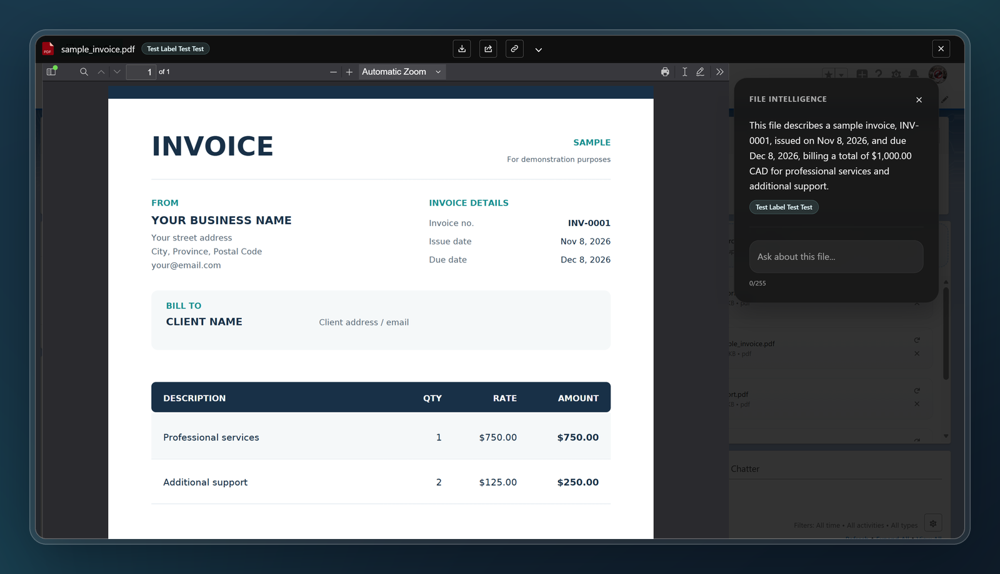
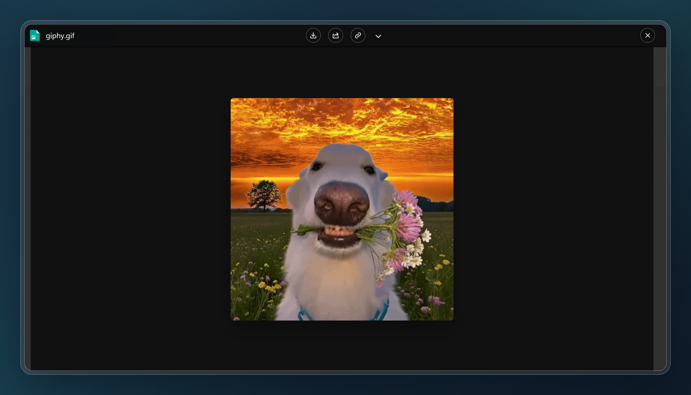
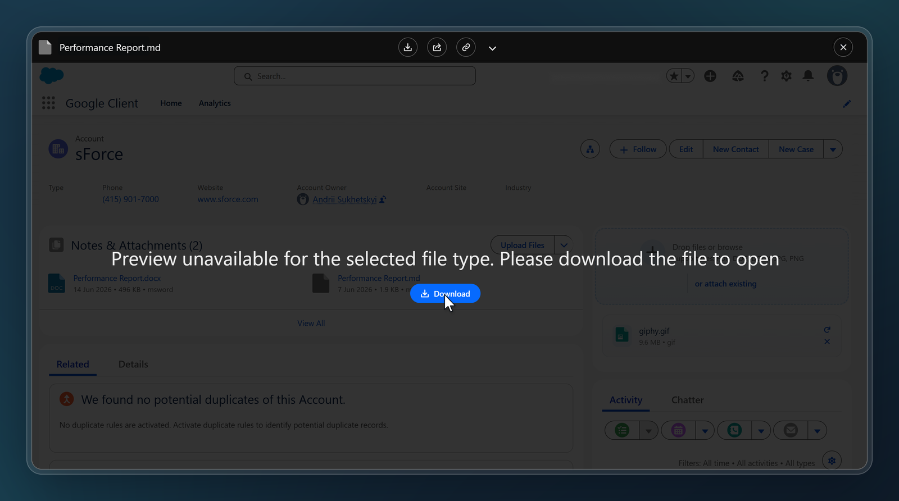
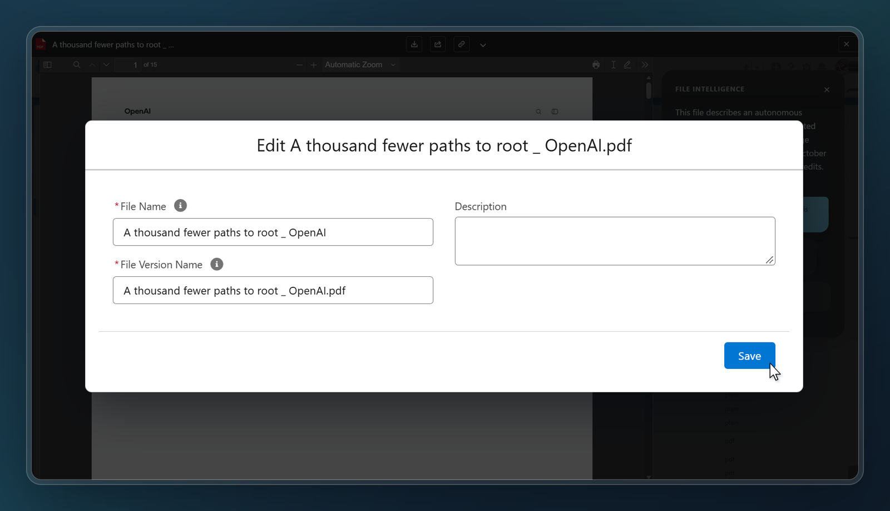
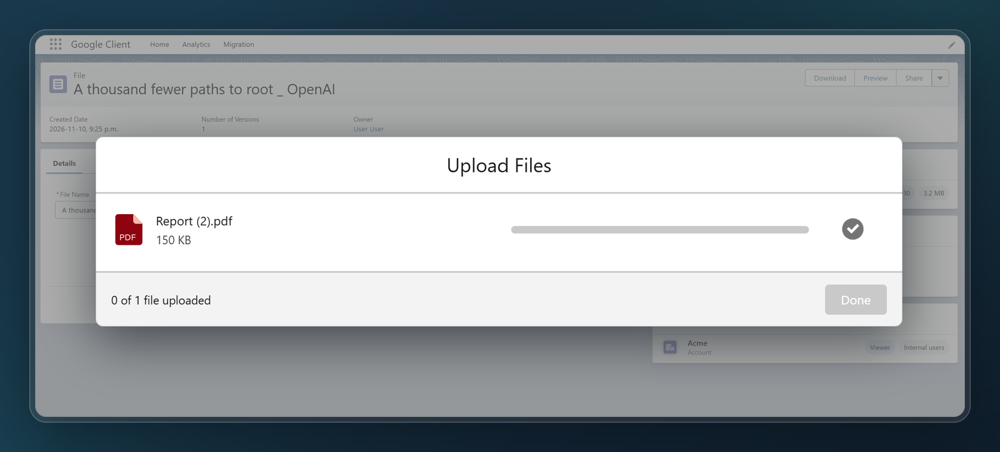
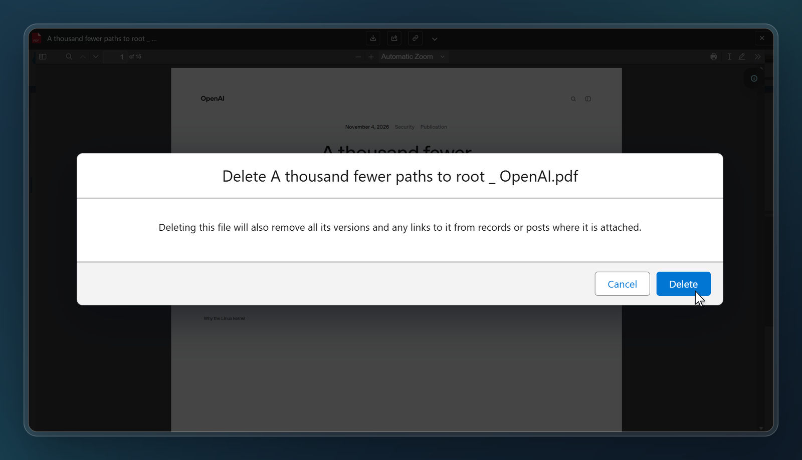
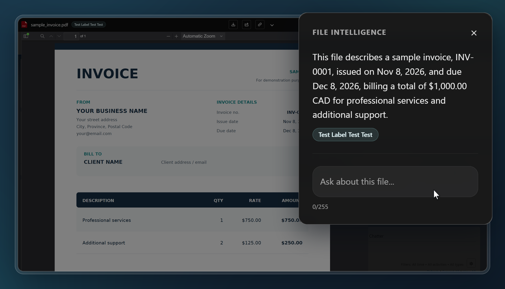

# Preview

The preview window is where people work with a Google Client file inside Salesforce. It opens from the record components, File Explorer, the View All page and Experience Cloud sites, wherever the user has access to the file.

## What it shows

The file stays in Google Drive, and the preview shows it inside Salesforce:

- PDFs and images, including large ones
- Documents, spreadsheets and CSV files
- The version you opened, with older versions on the file details page
- The AI summary and questions panel, when AI Analytics is on

## Which files can be previewed

PDFs and images are shown as they are, except SVG and TIFF images. Documents and spreadsheets are shown through a Google Workspace copy that Google Client makes in Google Drive after the upload, so right after an upload a document may say **Preview is being prepared** for a minute or two.

A document is previewed up to the **Maximum Preview File Size** setting. The copy is usually far smaller than the uploaded file, so even a large document often previews.

A file that cannot be previewed still opens in the preview window, with **Download** and everything else you can do with it.

## Store files only

When an administrator turns on **Store files only**, Google Client stops making Google Workspace copies. PDFs and images still preview, while documents and spreadsheets open on the "Preview unavailable" screen with **Download**, and Download As and questions to the AI are not offered.

📘 See [Advanced: File Management](../config/advanced/file-management.md)

## Available actions

Depending on your access, the preview window offers:

- Download, and [Download As](download-as.md) for documents and spreadsheets
- Share
- Public Link
- View File Details
- Edit File Details
- Upload New Version
- Delete
- Open in Google Drive, for the file's owner when an administrator has turned it on

Viewers get the actions that read the file. Collaborators and owners also get the actions that change it.

### Edit File Details

Changes the file name, the description and the name of the version you have open.

### Upload New Version

Adds a new version of the file, which becomes the current one. Earlier versions stay on the file details page.

📘 See [Versioning](versioning.md)

### Delete

Removes the file with all its versions, and its links to every record and post it is attached to.

## AI panel

When AI Analytics is on and the file can be analyzed, a side panel shows the file's summary and labels, with a box for asking questions about it.

📘 See [AI & Intelligence](artificial-intelligence/overview.md)

 
