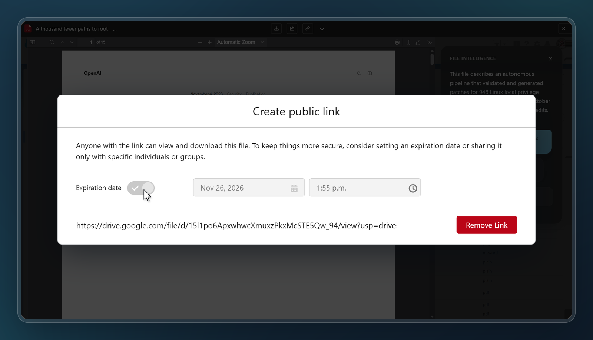
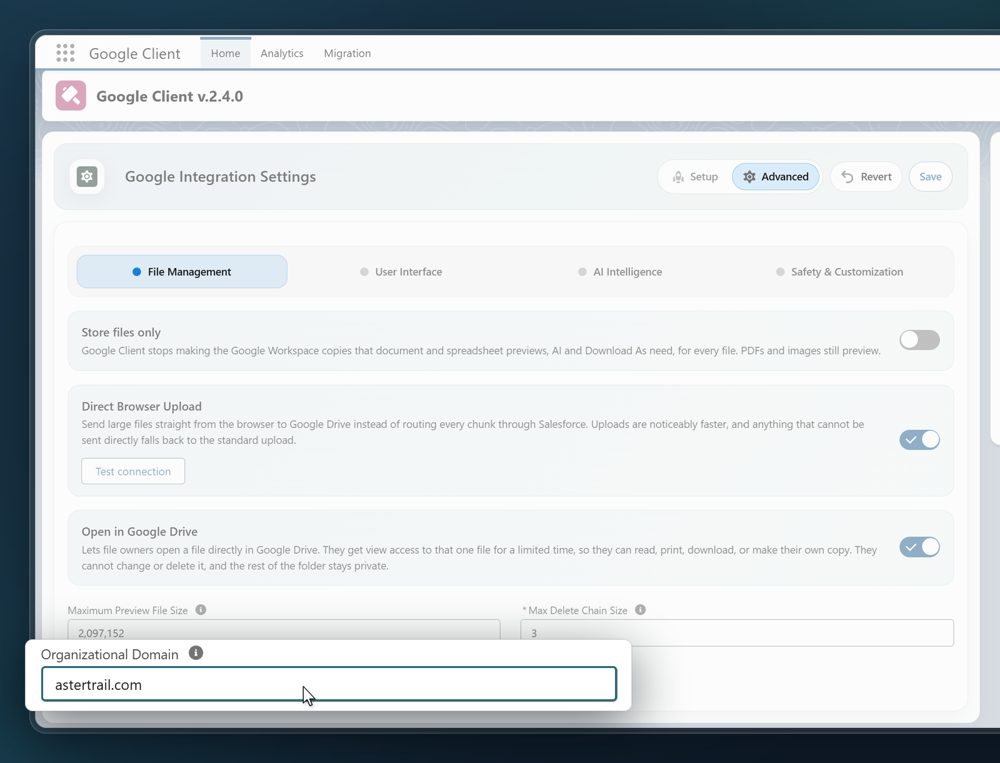

# Public Links

Public links let users with **Collaborator** access share a file with people who have **no** Salesforce access, such as:

- Contractors
- External partners
- Vendors
- Anyone you work with by email

## How it works

A public link:

- Is created from Salesforce
- Can carry an expiry date
- Needs **no** Salesforce login to open
- Opens the file in a **Google Drive view** in a separate tab

## Limiting links to your domain (optional)

You can keep public links inside your **organization's domain**, for example `astertrail.com`. The link can still be passed around, but **only people signed in under that domain** can open it.

An administrator sets the domain under **Advanced** → **File Management**. Once it is set, every new link is limited to the domain unless the person creating it ticks the checkbox in the Public Link window to make that one link open for anyone.

📘 See [File Management](../config/advanced/file-management.md)

## Creating a public link

1. Open a file.
2. The file opens in the **preview window**.
3. Click the **Public Link** button, the third button on the toolbar.
4. Set an expiry date, if the link should stop working on its own.
5. Create the link.

You get a link you can copy and share straight away.

## Access

- Recipients view the file through Google Drive.
- A link can be withdrawn at any time.
- A link is withdrawn automatically on its expiry date.
- When links are limited to your domain, recipients outside it cannot open them.

External sharing this way needs **no extra Salesforce licenses**.

📘 See [Public Link Expiration](flows-automation/expire-public-link-action.md) to withdraw links from a flow.

 
