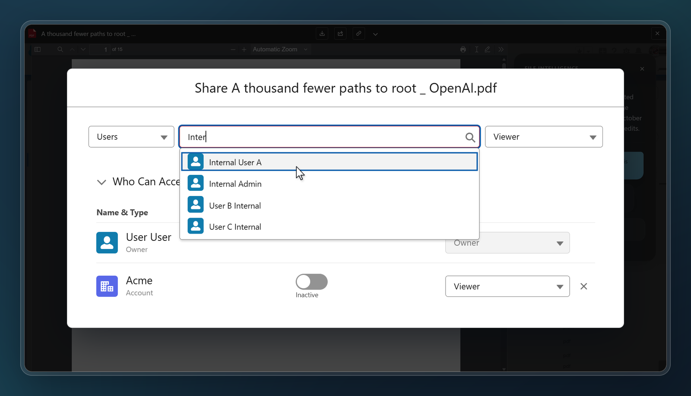
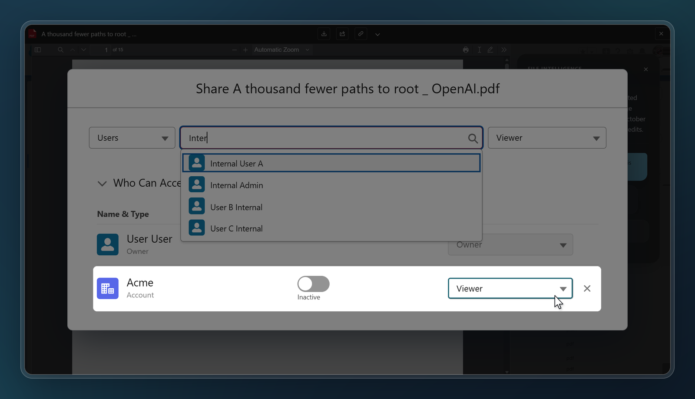

# Sharing

Sharing lets people work together on a file inside your Salesforce organization, without Salesforce Files as the storage.

In Google Client, a file reaches people through **two separate paths**:

1. **Direct sharing**: share the file with a user, a group or a queue.
2. **Record link access**: link the file to a Salesforce record and decide what that link grants.

Google Client combines both paths and applies the **highest** access level the user qualifies for.

In 2.0.0, a file can be linked to more than one Salesforce record. Each valid record link can give access, which makes file reuse practical without losing control of who sees what.

## How to open sharing

1. Open a file in Salesforce.
2. The file opens in the **preview window**.
3. Click the **Share** button, the second button on the toolbar.

## 1. Direct sharing with people and groups

Users with **Collaborator** access can share a file directly with:

- Internal users
- Public groups
- Queues
- Experience Cloud users, where the site allows it

Some sharing changes are reserved for the file's owner.

### Access levels for direct sharing

- **Viewer**: can view and download the file.
- **Collaborator**: full access, including changes and new versions.

## 2. Record link access

A file can be **linked to a Salesforce record**, such as an Account, a Case or an Opportunity. Each link has a **Share Type** that decides what access the record can give.

The same file can be linked to several records, so one Google Drive file can appear on several records without duplicate uploads.

### Share Type

| Share Type | What it grants |
|---|---|
| **None** | **No access** through the record. The link is kept only to show where the file belongs. |
| **Viewer** | **View** access to anyone who can see the record |
| **Set by Record** | Access that follows the user's access to the record: Edit on the record gives Edit, Read gives View |

## How access is decided

For every file, Google Client looks at:

- Who owns it
- Direct shares with users, groups and queues
- Every valid record link and its Share Type
- Whether the user is internal or external

When several of these apply, the **highest** access level wins.

Record links never expose a file through unrelated records. A user needs a valid path to the file through ownership, direct sharing or one of the records it is linked to.

📘 See [Security & Access Model](../security.md) for the full rules.

 
