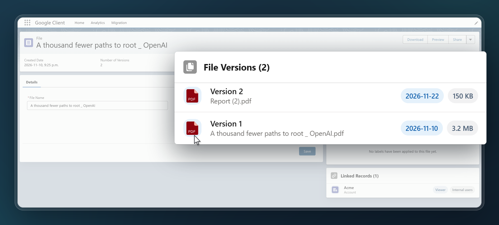

# Versioning

Versioning keeps a file's history when it changes. Users with **Collaborator** access can upload a new version of a file at any time.

## How versioning works

When someone uploads a new version:

- The newest version becomes the **current** one
- Earlier versions are kept for review and audit
- Sharing and access stay exactly as they were

Previews, downloads, record lists and File Explorer always use the current version. Earlier versions stay available from the file details page.

## Viewing earlier versions

1. Open the file's **File Details** page.
2. Find the **Versions** card.
3. Select any version to preview or download it.

Nothing is lost when a file changes, which matters for collaboration and for regulated work where file history has to be kept.

 
