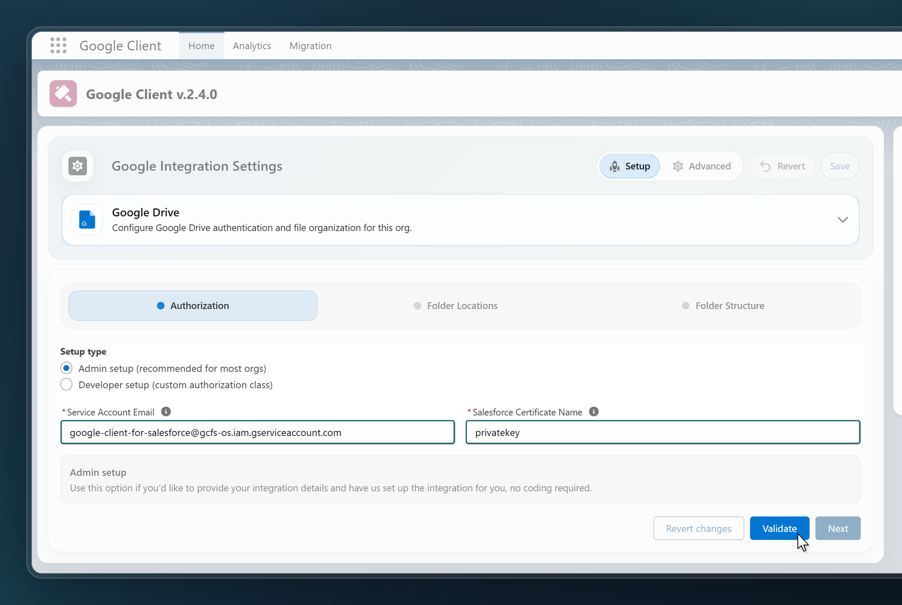
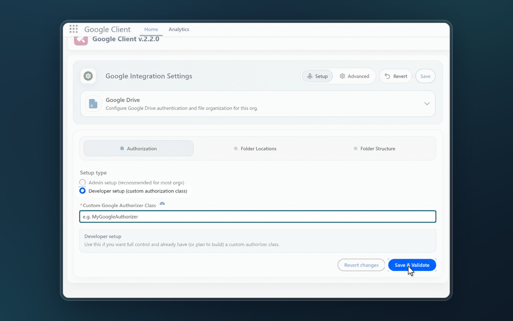

# Configure Google Workspace

Connect Google Drive in the Google Client app. This is the one integration Google Client requires, and it turns on every file feature: upload, preview, sharing, versioning and folder structure.

!!! note
    Haven't installed the package yet? Start here: [Install & Upgrade](../install-overview.md)

## Before you begin

Before you can configure the app, give yourself access to it.

### Step 1: Assign the admin permission set

Assign the **Google Cloud Client Admin** permission set to your user. It grants access to the **Google Client** app and its configuration.

### Step 2: Open the Google Client app

1. Open the **Google Client** app from the App Launcher.
2. You land on the **Home** page, which shows the current configuration status, the authentication details and any setting that is missing or incomplete.

### Step 3: Configure authentication

Google Client offers two ways to set up authentication:

1. **Admin setup (recommended for most orgs)**, which needs no Apex code
2. **Developer setup (custom authorization class)**, for advanced or fully custom scenarios

Both need the **Salesforce certificate** (JKS) you uploaded on the [Configure Certificate](configure-certificate.md) page, and your **service account email**.

#### Option A: Admin setup, no code

Use this option to set up authentication through the screen:

1. Select **Admin setup (recommended for most orgs)**.
2. Enter the **Service Account Email**.
3. Enter the **Salesforce Certificate Name**, the certificate you uploaded earlier.
4. Click **Save & Validate**.

#### Option B: Developer setup with your own class

Use this option when you need your own way of getting tokens, or want full control of authorization in Apex:

1. Select **Developer setup (custom authorization class)**.
2. Create an Apex class that implements the Drive library's authorization interface.
3. Enter the class name in the **Custom Google Authorizer Class** field.
4. Click **Save & Validate**.

📘 Reference documentation: [Library Authorization Flow](https://github.com/sandriiy/salesforce-google-drive-library/wiki/Library-Authorization-Flow){ target="_blank" rel="noopener noreferrer" }

### Step 4: Choose where files are stored

After authentication is configured:

1. In the **Folder Locations** step, enter the ID of the Google Drive folder that files are uploaded to.
2. Share that folder with the service account.
3. Click **Save**.

## Where to go next

Google Workspace is now configured, and file management works end to end. Everything from here is optional:

- [Folder Structure](../config/folder-structure.md) organizes uploads in Google Drive by user, by record or both, and sets how those folders are named.
- [Multiple Upload Folders](../config/multiple-drives.md) adds fallback destinations, so uploads keep working when a drive reaches its capacity limit.
- [Google Workspace Folder](../config/workspace-copies-folder.md) keeps the copies made for previews, AI and Download As out of record folders.
- [Advanced Settings](../config/advanced-settings.md) holds Store files only, upload transport, public link scope and File Explorer columns.

!!! note
    Want document summaries, file Q&A and automatic labels as well? That is a separate, optional layer: [Configure AI & Intelligence](configure-intelligence.md)

 
