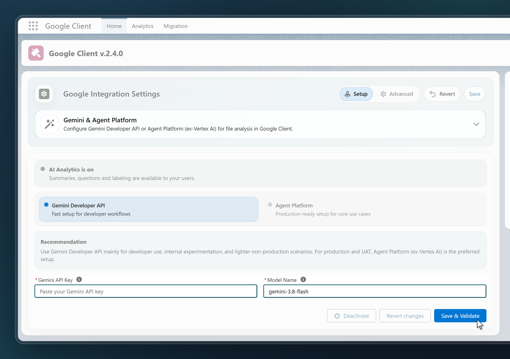
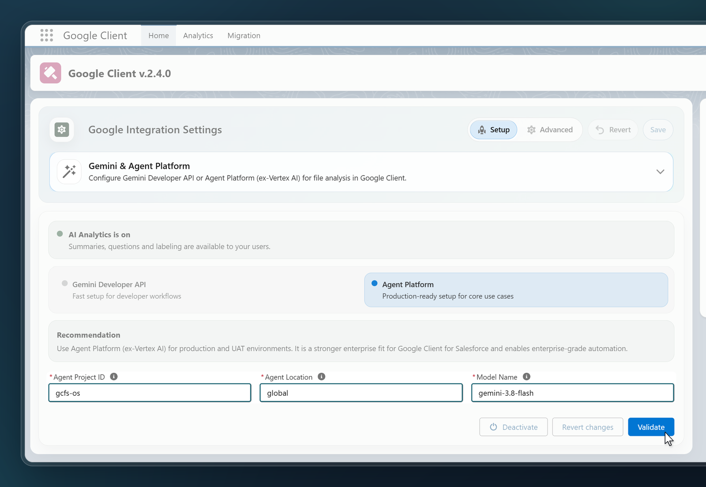
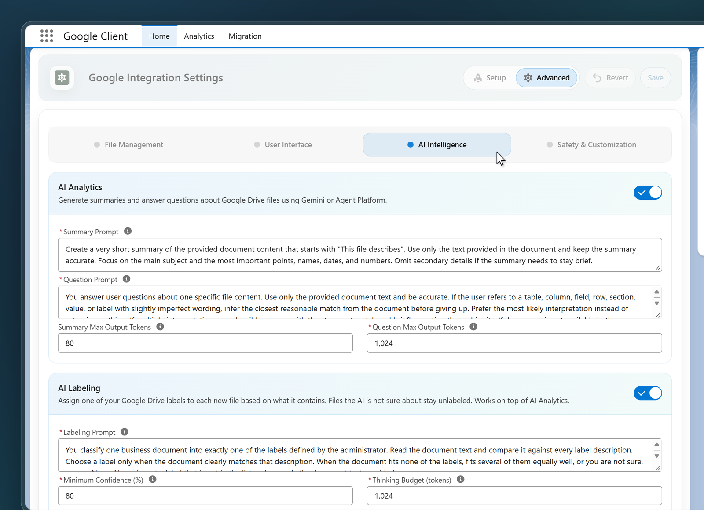

# Configure AI & Intelligence

Connect an AI provider in the Google Client app. Once it is set up, Google Client can summarize files, answer questions about them and label them automatically.

!!! note
    Haven't configured Google Drive yet? That step comes first: [Configure Google Workspace](configure-drive.md)

## Before you begin

AI & Intelligence is an optional layer on top of the Google Drive integration, so Google Drive must already be configured and working.

### Step 1: Open the Google Client app

1. Open the **Google Client** app from the App Launcher.
2. Go to the **Home** page.
3. Expand the **Gemini & Agent Platform** section under **Google Integration Settings**.

While you work, the side panel of the Home page shows a short guide for the provider you selected.

### Step 2: Choose a provider

Google Client connects to Google's AI services in one of two ways:

1. **Gemini Developer API**, set up with an API key
2. **Agent Platform** (Gemini Enterprise Agent Platform, formerly Vertex AI), set up with the service account

Both offer the same features. Agent Platform keeps AI usage under the same Google Cloud project, billing and audit as the rest of the integration.

#### Option A: Gemini Developer API

It signs in with an API key from Google AI Studio and needs no Google Cloud project configuration.

1. Select **Gemini Developer API**.
2. Go to [Google AI Studio](https://aistudio.google.com/apikey){ target="_blank" rel="noopener noreferrer" } and create or select a project.
3. Generate a **Gemini API Key**.
4. Paste the key into the **Gemini API Key** field.
5. Set the **Model Name**, for example `gemini-3.8-flash`.
6. Click **Save & Validate**.

!!! note
    A notice in the corner of the page reminds you that AI analysis is still off. That is expected at this point: the provider is saved and validated here, and analysis is switched on in Step 3.

#### Option B: Agent Platform

It signs in with the **same service account** you already use for Google Drive, which only needs the **Vertex AI User** role on the target project.

1. Select **Agent Platform**.
2. In the [Google Cloud Console](https://console.cloud.google.com/){ target="_blank" rel="noopener noreferrer" }, open the target project, check that billing is active and enable the **Vertex AI API**.
3. Grant the service account you use for Google Drive the **Vertex AI User** role on that project.
4. Enter the **Agent Project ID**, your Google Cloud project ID, for example `my-google-cloud-project`.
5. Enter the **Agent Location**, the region where the model runs, for example `us-central1` or `global`.
6. Set the **Model Name**, for example `gemini-3.8-flash`.
7. Click **Save & Validate**.

### Step 3: Turn on AI Analytics

Open **Advanced** → **AI Intelligence** and turn on **AI Analytics**, then save.

The switch becomes available once a provider is saved. Turning it on checks the provider straight away and says if it is not ready.

With AI Analytics off, every Google Drive feature keeps working and the AI summaries, questions and labels are simply not offered.

### Step 4: Review the prompts and limits

Google Client ships working prompts for summaries and questions, so AI works the moment validation passes. These settings can be changed at any time:

- **Summary Prompt** sets how the provider is asked to describe a file.
- **Question Prompt** sets how it is asked to answer a user's question.
- **Summary Max Output Tokens** and **Question Max Output Tokens** set how long a summary and an answer may be. Answer length is what drives most of your provider costs.

📘 See [AI Intelligence settings](../config/advanced/ai-intelligence.md)

## Where to go next

- [AI & Intelligence overview](../features/artificial-intelligence/overview.md): how the layer works and what it does not do
- [Document Summaries](../features/artificial-intelligence/summaries.md): where summaries appear and when they are made
- [File Q&A](../features/artificial-intelligence/file-qa.md): how users ask, and what will not be answered
- [File Labeling](../features/artificial-intelligence/labeling.md): automatic Google Drive labels based on content

 
