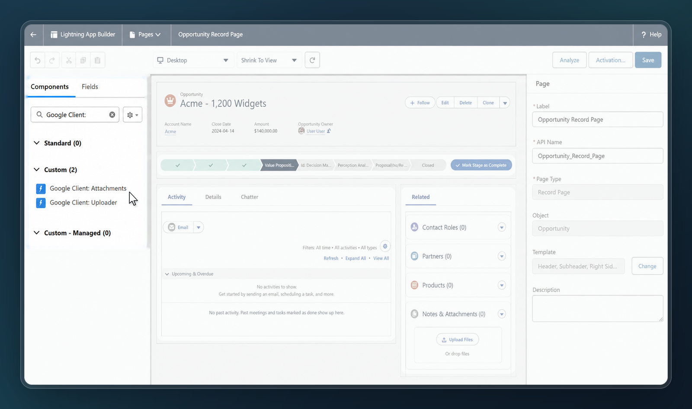
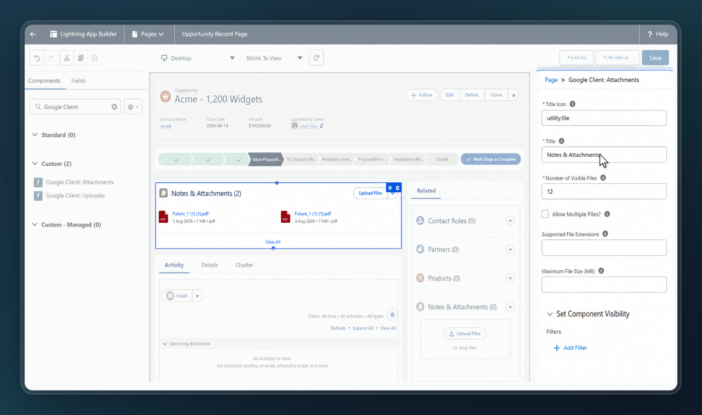
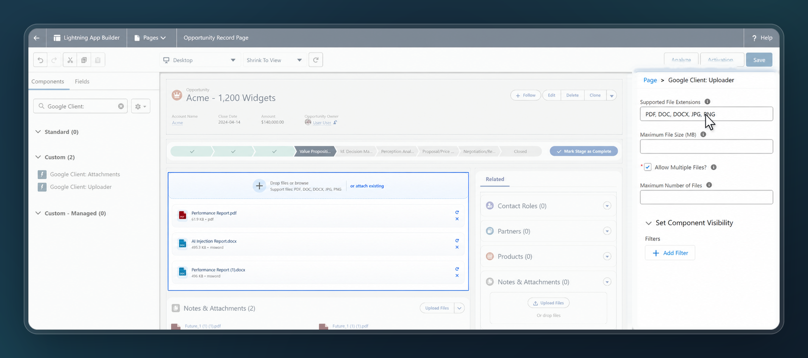

# Configure Components (Core Clouds)

Add Google Client components to standard Lightning pages in **Sales Cloud, Service Cloud, custom Lightning apps or any standard Lightning record page**. Experience Cloud needs two fixed pages of its own and is covered separately in [Configure Components (Experience Cloud)](experience-cloud.md).

Every placeable Google Client component is added with the Lightning App Builder:

1. Open Salesforce in Lightning Experience.
2. Go to the page where you want the components: a **Home page**, an **App page** or a **Record page**.
3. Click the ⚙️ Setup icon in the top right corner.
4. Select **Edit Page**.

The Lightning App Builder opens, and you can drag the components onto the page and configure them.

## Components you can place

These are the components you place yourself, listed by their labels in the Lightning App Builder.

### Google Client: Attachments

Full Google Drive file management for a Salesforce record, in a list that works like Notes & Attachments.

**Where it can be used:** record pages.

**Properties**

- **Title Icon**: the icon in the component header.
- **Title**: the component title.
- **Number of Visible Files**: how many files are shown before **View All** is needed.
- **Allow Multiple Files?**: lets users pick several files at once.
- **Supported File Extensions**: the file types users may upload.
- **Maximum File Size (MB)**: the upload size limit per file.

**Typical use**

- Replaces Salesforce Files for record attachments, with the documents stored in Google Drive.
- Lets users upload new files or attach Google Client files they already own to the record.
- Opens preview, sharing, public links, versions and file details from one familiar record component, and its **View All** page lets users [download several files at once](../features/bulk-download.md).

### Google Client: Uploader

A dedicated upload area for adding files to Google Drive from Salesforce. **It has been available in Screen Flows since version 1.1.**

**Where it can be used:** record pages, and [Screen Flows](../features/flows-automation/uploader-screen-flows.md).

**Properties**

- **Supported File Extensions**: the file types users may upload.
- **Maximum File Size (MB)**: the upload size limit per file.
- **Allow Multiple Files?**: lets users upload several files at once.
- **Maximum Number of Files**: limits how many files can be uploaded.

**Typical use**

- Replaces Salesforce Files with a dedicated upload area for a record, including a limit on the number of files, for example one file per record.
- Lets users attach Google Client files they already own when the component sits on a record page.
- Lets users tick several of the listed files and [download them together](../features/bulk-download.md) as one ZIP archive.

### Google Client: Record Page Details

Shows a single Google file with its preview, sharing, public link, download, versions and linked Salesforce records.

**Where it can be used:** record pages. It shows one Google file, so it only has something to display on a **Google File** record page.

**Typical use**

- You normally do not need to place it. Google Client already overrides the Google File **View** action with a page that hosts this component, so opening a file from global search or a direct link lands on it.
- Place it yourself only when you build your own Google File record page instead of the shipped one.

## Components you do not place

Previews, sharing, public links, versions and the windows for deleting, sharing, attaching existing files, Download As and file details cannot be added in the Lightning App Builder. Google Client opens them itself when a user opens a file, clicks **View All**, attaches an existing file, edits details, shares, creates a public link, downloads in another format or works with versions.

## What users get after placement

Once the record components are on the page, users work with Google Drive files directly from the Salesforce record:

- Upload new files to Google Drive
- Attach Google Client files they already own to the record
- Preview supported files, including large PDFs and images
- Download files one at a time or several at once, or use Download As where it is offered
- Share files, create public links and manage versions
- Open file details to see versions and linked Salesforce records

Experience Cloud follows different placement and navigation rules. Use the [Experience Cloud guide](experience-cloud.md) when you configure a site.

 
