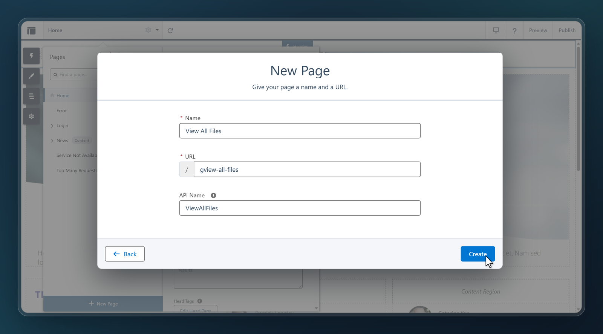
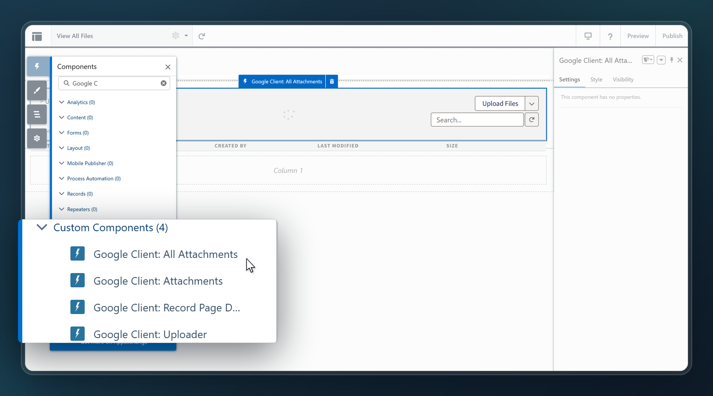

# Configure Components (Experience Cloud)

Use **Google Client** components on **Experience Cloud** sites. They work on both **LWR** and **Aura** sites.

An Experience Cloud site needs a little more setup than a Lightning page, because a site only navigates to pages that exist in it. Google Client needs two fixed pages, one for **View All** and one for **File Details**, before its record components work correctly.

If you are configuring standard Lightning record pages instead, use [Configure Components (Core Clouds)](core-clouds.md).

## Required pages

Create **two empty pages** in the site, with exactly these **URLs**:

- **gview-all-files** opens when a user clicks **View All**. Give it a friendly name such as "View All Files".
- **gfile-details** opens when a user clicks **View File Details**. Give it a friendly name such as "File Details".

## Creating the required pages

1. Open your Experience Cloud site in Salesforce.
2. Click **Builder** to open Experience Builder.
3. Open the **Pages** panel in the top left corner.
4. Click **New Page**.
5. Select **Standard Page**.
6. Click **New Blank Page**.
7. Choose the **1 full-width column** layout.
8. Create the first page:
    - Name: View All Files (or similar)
    - API Name: ViewAllFiles (or similar)
    - URL: **gview-all-files**
9. Create the second page:
    - Name: File Details (or similar)
    - API Name: FileDetails (or similar)
    - URL: **gfile-details**

## Place the page components

Each of the two pages hosts one Google Client component. Your users never work with these pages directly. Google Client opens them after a user clicks **View All** or **View File Details**.

### Page: gview-all-files

1. Open the **gview-all-files** page in Experience Builder.
2. Find **Google Client: All Attachments** in the components panel.
3. Drag it into the main content area. A single, wide section works best.

### Page: gfile-details

1. Open the **gfile-details** page in Experience Builder.
2. Find **Google Client: Record Page Details** in the components panel.
3. Drag it into the main content area. A single, wide section works best.

After placing both components, click **Publish**. The navigation Google Client needs is now in place.

## Components you can place on record pages

With the two pages in place, you can add Google Client components to record pages of the site.

### Google Client: Attachments

Full Google Drive file management for a Salesforce record, a complete replacement for Notes & Attachments.

**Where it can be used:** Experience Cloud record pages.

**Properties to set**

- **Record Id**: enter `{!recordId}` so the component follows the record on the page.
- **Object API Name**: enter the API name of the object the page shows.

**Typical use**

- The main file list for records shown on the site.
- Lets external users upload new files or attach Google Client files they own, where their access allows it.
- Opens the **View All Files** page when needed, where users can [download several files at once](../features/bulk-download.md).

### Google Client: Uploader

A dedicated upload area for adding files to Google Drive from an Experience Cloud site.

**Where it can be used:** Experience Cloud record pages.

**Properties to set**

- **Record Id**: enter `{!recordId}` so the component follows the record on the page.

**Typical use**

- A controlled upload area for external or community users.
- Offers the same preview, sharing, versions and attach-existing options when the user has the access they need.
- Lets users tick several of the files they can see and [download them together](../features/bulk-download.md) as one ZIP archive.

## What users get after placement

Experience Cloud users are covered by the same security model as everyone else. Access comes from ownership, direct sharing, record access, internal or external visibility and the records a file is linked to.

Depending on their access, users can upload, attach files they own, preview supported files, download, share, manage public links and open file details without leaving the site.

## Things to check

- The two pages must exist before the record components work correctly.
- The page URLs must match exactly: `gview-all-files` and `gfile-details`.
- Each record component needs `{!recordId}` in its **Record Id** property.

 
